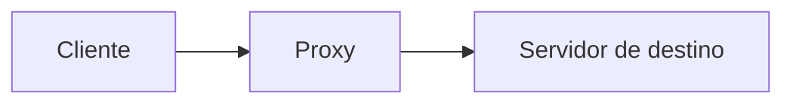

# 6.3 · Cookies, cache e proxy

> **Em uma frase:** **cookies** guardam pequenos dados no navegador para "lembrar" o usuário entre requisições, o **cache** guarda cópias de respostas para não buscá-las de novo, e um **proxy** é um intermediário entre cliente e servidor.

## 🍪 Cookies

Como o HTTP não tem estado, o servidor usa cookies para reconhecer o usuário nas próximas requisições:

```mermaid
sequenceDiagram
    participant N as Navegador
    participant S as Servidor
    N->>S: POST /login (usuário e senha)
    S-->>N: 200 OK + Set-Cookie: sessao=abc123; HttpOnly; Secure
    N->>S: GET /minha-conta + Cookie: sessao=abc123
    S-->>N: 200 OK (página da conta do usuário)
```

| Uso | Exemplo |
| --- | --- |
| **Sessão / autenticação** | Manter o login ativo |
| **Preferências** | Idioma, tema escuro |
| **Rastreamento** | Anúncios e análises (exigem consentimento pela LGPD) |

### Atributos de segurança

| Atributo | Para quê |
| --- | --- |
| `HttpOnly` | O JavaScript da página não consegue ler o cookie (protege contra roubo via XSS). |
| `Secure` | Só é enviado por HTTPS. |
| `SameSite` | Restringe o envio em requisições vindas de outros sites (protege contra CSRF). |
| `Max-Age` / `Expires` | Validade do cookie. |

## 🗄️ Cache

Guardar cópias de respostas para não refazer o trabalho:

| Tipo | Onde fica | Exemplo |
| --- | --- | --- |
| **Do navegador** | No computador do usuário | Imagens, CSS e JS de um site |
| **De rede / CDN** | Em servidores espalhados pelo mundo | Cloudflare, Amazon CloudFront |
| **Do servidor / aplicação** | No backend | Redis com resultados de consultas frequentes |

O HTTP controla o cache com cabeçalhos:

```text
Cache-Control: public, max-age=3600       ← pode guardar por 1 hora
Cache-Control: no-store                   ← nunca guarde (dados sensíveis)
ETag: "v42"                               ← "versão" do recurso
```

Com o `ETag`, o navegador pergunta "ainda é a versão v42?" (`If-None-Match: "v42"`) e, se nada mudou, o servidor responde `304 Not Modified` **sem corpo**, economizando banda.

## 🔀 Proxy

Um servidor **intermediário** entre o cliente e o destino:



| Benefício | Exemplo |
| --- | --- |
| **Desempenho** | Guarda em cache páginas acessadas com frequência. |
| **Controle de acesso** | A empresa bloqueia certos sites. |
| **Privacidade** | O site de destino vê o IP do proxy, não o do cliente. |
| **Segurança** | Filtra conteúdo malicioso. |

> [!NOTE]
> Esse é o proxy **direto** (*forward proxy*), que age em nome do **cliente**. O **proxy reverso** age em nome do **servidor** e é muito usado na frente de APIs (aula [6.9](./09-conceitos-de-rede.md)).

## 📌 Resumindo

- Cookies dão "memória" ao HTTP; use `HttpOnly`, `Secure` e `SameSite`.
- Cache evita trabalho repetido; é controlado por `Cache-Control` e `ETag`.
- Proxy é um intermediário que melhora desempenho, controle e privacidade.

## 🏋️ Mão na massa

**1.** Abra o DevTools (`F12`) → **Application/Aplicativo** → **Cookies** em um site em que você está logado. Quais cookies têm `HttpOnly`?

<details>
<summary>Ver resposta</summary>

Na tabela de cookies, a coluna **HttpOnly** mostra um ✓. Normalmente, os cookies de sessão/autenticação são `HttpOnly` e `Secure`, enquanto cookies de preferência (tema, idioma) podem não ser.

</details>

**2.** Qual cabeçalho usar para impedir que uma página com dados bancários fique em cache?

<details>
<summary>Ver resposta</summary>

`Cache-Control: no-store`, que proíbe qualquer armazenamento da resposta.

</details>

**3.** O que significa a resposta `304 Not Modified`?

<details>
<summary>Ver resposta</summary>

Que o recurso não mudou desde a versão que o navegador já tem em cache. O servidor responde sem corpo, e o navegador usa a cópia local.

</details>

---

<div align="center">

[⬅️ 6.2 Mensagens HTTP](./02-mensagens-http.md) &nbsp;|&nbsp; [🏠 Índice](../../README.md) &nbsp;|&nbsp; [6.4 HTTP/2 e HTTP/3 ➡️](./04-http2-e-http3.md)

</div>
