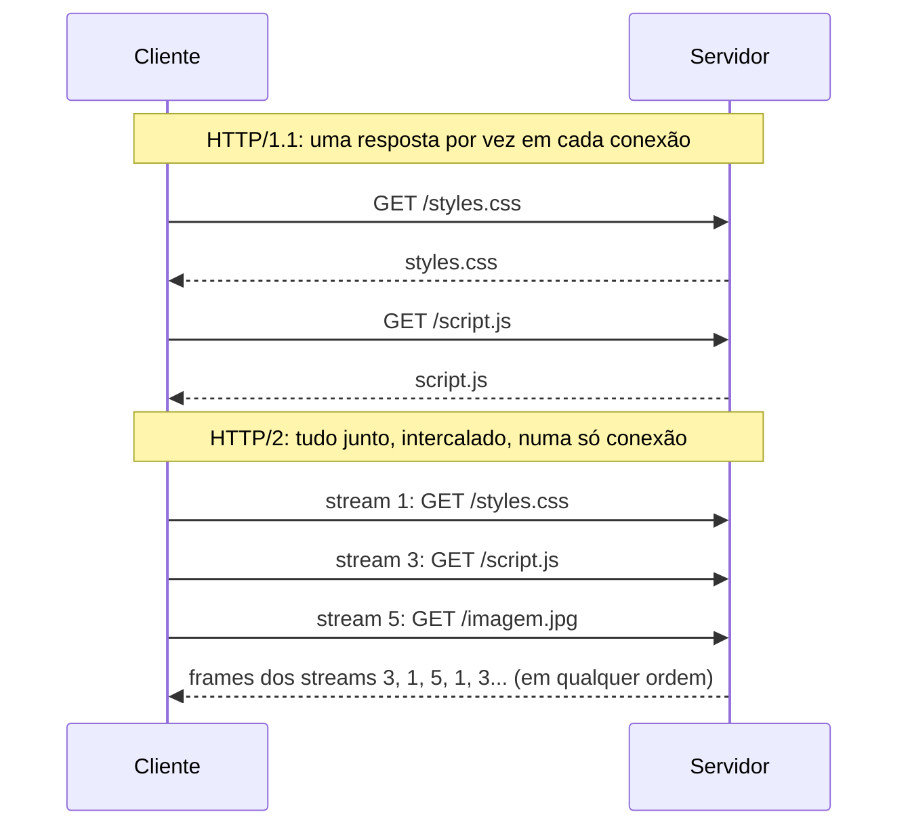

# 6.4 · HTTP/2 e HTTP/3

> **Em uma frase:** o **HTTP/2** deixou a web mais rápida enviando várias requisições ao mesmo tempo em uma única conexão (multiplexação) e comprimindo os cabeçalhos; o **HTTP/3** vai além trocando o TCP pelo **QUIC**, que roda sobre UDP.

## 🚀 O que o HTTP/2 trouxe

### 1. Formato binário e *streams*

As mensagens deixam de ser texto e passam a ser divididas em **frames** binários, cada um marcado com o ID do **stream** (a "conversa") a que pertence. O conteúdo lógico (método, cabeçalhos, corpo) continua o mesmo.

### 2. Multiplexação

No HTTP/1.1, as conexões já eram **persistentes** (reaproveitadas), mas em cada uma só cabia uma resposta por vez, e os navegadores abriam várias conexões paralelas. No HTTP/2, uma única conexão carrega todas as requisições ao mesmo tempo, eliminando o *head-of-line blocking* na camada HTTP.

### 3. Compressão de cabeçalhos (HPACK)

Requisições seguidas repetem quase os mesmos cabeçalhos (`User-Agent`, `Cookie`...). O **HPACK** comprime os cabeçalhos e envia só o que mudou, economizando banda.

### 4. Priorização

O cliente pode indicar quais streams são mais importantes (por exemplo, o CSS antes das imagens).

### 5. *Server push* (descontinuado)

O servidor podia enviar recursos antes de o cliente pedir. Na prática, o ganho foi pequeno e o recurso foi **removido do Chrome em 2022** e é desaconselhado. Hoje usam-se alternativas como o cabeçalho `Link: rel=preload` e a resposta `103 Early Hints`.

> [!NOTE]
> A especificação do HTTP/2 **não exige** TLS, mas todos os navegadores só usam HTTP/2 com HTTPS. Na prática, HTTP/2 na web significa HTTPS. A versão é combinada durante o *handshake* do TLS, por uma extensão chamada **ALPN**.

## ⚡ HTTP/3 e QUIC

Mesmo com o HTTP/2, um único pacote TCP perdido trava **todos** os streams da conexão até ser retransmitido (o HOL blocking voltou, só que na camada de transporte). O **HTTP/3** (2022) resolve isso usando o **QUIC**:

| | HTTP/1.1 | HTTP/2 | HTTP/3 |
| --- | --- | --- | --- |
| Transporte | TCP | TCP | **QUIC (sobre UDP)** |
| Formato | Texto | Binário | Binário |
| Várias requisições por conexão | Uma de cada vez | Multiplexadas | Multiplexadas e independentes |
| Perda de pacote trava tudo? | Sim | Sim (no TCP) | **Não**: só o stream afetado |
| Criptografia | Opcional (HTTPS) | Na prática, sempre | **Obrigatória** (TLS 1.3 embutido) |
| Estabelecer conexão | TCP + TLS (vários envios) | TCP + TLS | Mais rápido (1 ida e volta, ou 0 se reconectar) |

> [!TIP]
> Na aba **Network** do DevTools, ative a coluna **Protocol**: `http/1.1`, `h2` (HTTP/2) e `h3` (HTTP/3). Sites como Google e YouTube já usam `h3`.

## 📌 Resumindo

- HTTP/2: binário, multiplexação numa só conexão, compressão de cabeçalhos (HPACK) e priorização.
- O *server push* foi abandonado.
- HTTP/3: usa QUIC sobre UDP, elimina o bloqueio por perda de pacote e tem TLS 1.3 embutido.

## 🏋️ Mão na massa

**1.** Qual problema a multiplexação do HTTP/2 resolve?

Ver resposta

A necessidade de esperar uma resposta terminar para receber a próxima na mesma conexão (o *head-of-line blocking* do HTTP). Com a multiplexação, várias requisições e respostas trafegam ao mesmo tempo numa única conexão.

**2.** Por que o HTTP/3 usa UDP, se o UDP "não garante entrega"?

Ver resposta

Porque o **QUIC** implementa por conta própria as garantias (entrega, ordem, controle de congestionamento), mas **por stream**. Assim, a perda de um pacote só afeta o stream dele, sem travar os outros, como acontece com o TCP.

**3.** Descubra, pelo DevTools, qual versão do HTTP o site `https://www.google.com` usa.

Ver resposta

Abra **F12 → Network**, ative a coluna **Protocol** (clique com o botão direito nos títulos das colunas) e recarregue a página. A maioria das requisições aparece como `h3` ou `h2`.

---

[⬅️ 6.3 Cookies, cache e proxy](./03-cookies-cache-proxy.md) &nbsp;|&nbsp; [🏠 Índice](../../README.md) &nbsp;|&nbsp; [6.5 Servidores web e de aplicação ➡️](./05-servidores-web.md)

