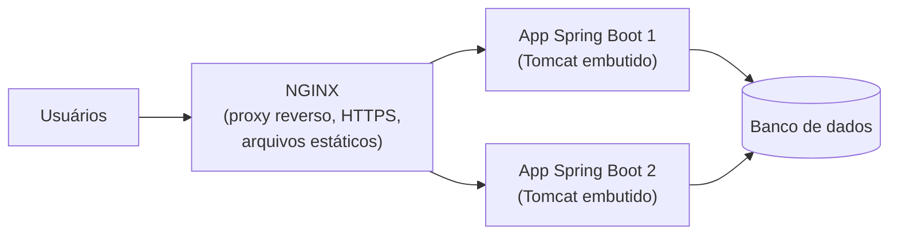

# 6.5 · Servidores web e de aplicação

> **Em uma frase:** um **servidor web** (Apache, NGINX) entrega arquivos e encaminha requisições; um **servidor de aplicação** ou *servlet container* (Tomcat, Jetty) executa o código da aplicação Java; e o Spring Boot já traz um deles **embutido**.

## 🌐 Os mais conhecidos

| Servidor | Tipo | Destaques |
| --- | --- | --- |
| **Apache HTTP Server** (1995) | Servidor web | Muito configurável e modular; foi o mais usado do mundo por décadas. |
| **NGINX** (2004, Igor Sysoev) | Servidor web, proxy reverso e balanceador | Criado para lidar com milhares de conexões simultâneas (o "problema C10K"); hoje é o mais usado na frente de aplicações. |
| **Apache Tomcat** | *Servlet container* Java | Executa aplicações Java web; é o padrão embutido no Spring Boot. |
| **Jetty** / **Undertow** | *Servlet containers* Java | Alternativas leves ao Tomcat, também suportadas pelo Spring Boot. |
| **XAMPP** | Pacote de desenvolvimento | Instala Apache + MariaDB (MySQL) + PHP + Perl de uma vez, para testes locais. |

> [!NOTE]
> O nome "Apache" é muitas vezes explicado como "*a patchy server*" (um servidor "remendado", feito de patches sobre o servidor NCSA). A própria fundação diz que o nome foi escolhido em homenagem à nação indígena Apache, e a piada surgiu depois.

## 🧭 Como eles trabalham juntos



Uma arquitetura típica coloca o **NGINX** na frente: ele recebe o HTTPS, entrega arquivos estáticos (imagens, CSS, JS) e distribui as requisições entre as instâncias da aplicação Java.

## ☕ E no Spring Boot?

Antigamente, era preciso instalar um Tomcat, gerar um arquivo `.war` e copiá-lo para dentro do servidor. Com o **Spring Boot**, o Tomcat vem **dentro** da aplicação:

```bash
mvn package
java -jar target/minha-api-0.0.1-SNAPSHOT.jar   # o servidor sobe junto, na porta 8080
```

Para trocar a porta, use `server.port=9090` no `application.properties`.

## 📌 Resumindo

- Apache e NGINX: servidores web/proxy; NGINX é o mais usado na frente de aplicações.
- Tomcat, Jetty, Undertow: executam aplicações Java web.
- O Spring Boot embute o Tomcat: basta `java -jar`.

## 🏋️ Mão na massa

**1.** Qual a diferença entre um servidor web como o NGINX e um *servlet container* como o Tomcat?

<details>
<summary>Ver resposta</summary>

O NGINX recebe requisições, serve arquivos estáticos e encaminha (proxy) para outros servidores, mas não executa código Java. O Tomcat executa a aplicação Java (servlets, Spring) que gera as respostas dinâmicas.

</details>

**2.** Como mudar a porta da sua aplicação Spring Boot para 8081?

<details>
<summary>Ver resposta</summary>

No `src/main/resources/application.properties`: `server.port=8081`. Ou, ao rodar: `java -jar app.jar --server.port=8081`.

</details>

**3.** Por que colocar um NGINX na frente de várias instâncias da sua API?

<details>
<summary>Ver resposta</summary>

Para **distribuir a carga** entre elas (balanceamento), cuidar do HTTPS num só lugar, servir arquivos estáticos rapidamente e continuar atendendo mesmo se uma instância cair.

</details>

---

<div align="center">

[⬅️ 6.4 HTTP/2 e HTTP/3](./04-http2-e-http3.md) &nbsp;|&nbsp; [🏠 Índice](../../README.md) &nbsp;|&nbsp; [6.6 Criptografia e certificados digitais ➡️](./06-criptografia-e-certificados.md)

</div>
