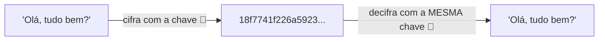
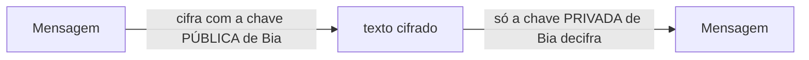
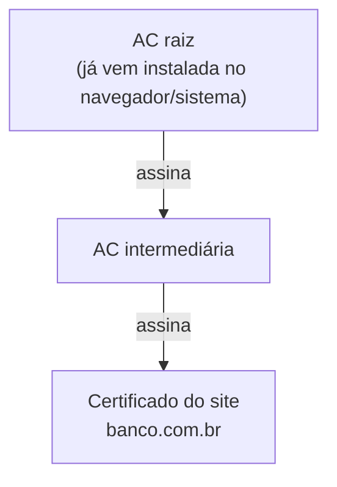

# 6.6 · Criptografia e certificados digitais

> **Em uma frase:** na criptografia **simétrica**, a mesma chave cifra e decifra (rápida, mas é preciso compartilhar a chave); na **assimétrica**, há um par de chaves pública/privada (resolve o compartilhamento); e o **certificado digital** prova a quem pertence uma chave pública.

## 🔑 Criptografia simétrica

- **Uma única chave**, conhecida pelos dois lados.
- **Muito rápida**: ideal para grandes volumes de dados.
- Problema: como entregar a chave para o outro lado sem que alguém a intercepte?
- Algoritmos: **AES** (o padrão atual) e **ChaCha20**. DES e 3DES são antigos e inseguros.

## 🗝️ Criptografia assimétrica

Cada pessoa tem um **par de chaves**:

- a **pública**, que pode ser distribuída para qualquer um;
- a **privada**, que nunca sai das mãos do dono.

| Uso | Como funciona |
| --- | --- |
| **Sigilo** | Cifra com a chave **pública** do destinatário; só a **privada** dele decifra. |
| **Assinatura digital** | O autor assina com a sua chave **privada**; qualquer um confere com a **pública**. Prova autoria e que nada foi alterado. |

- Algoritmos: **RSA** e **ECC** (curvas elípticas, chaves menores com a mesma segurança).
- É **bem mais lenta** que a simétrica.

> [!TIP]
> Na prática, os dois tipos trabalham **juntos**: a assimétrica é usada só para combinar com segurança uma chave simétrica, e a simétrica cifra os dados. É exatamente o que o TLS faz (próxima aula).

> [!NOTE]
> Não confunda **criptografia** (reversível, com chave) com **hash** (irreversível, como o SHA-256). Senhas devem ser guardadas com hash próprio para senhas, como o **bcrypt** (aula [6.20](./20-autenticacao.md)).

## 📜 Certificado digital

Como saber que a chave pública do "banco.com.br" é mesmo do banco, e não de um impostor? Por um **certificado digital**: um documento eletrônico que liga uma chave pública a uma identidade, **assinado** por uma **Autoridade Certificadora (AC)** confiável.

Um certificado contém: o nome do dono (ex.: o domínio), a chave pública, a validade e a assinatura da AC.

O navegador confere essa **cadeia de confiança** até uma AC raiz que ele já conhece. Se algo não bate (domínio diferente, certificado vencido, AC desconhecida), ele mostra um alerta de segurança.

### Autoridades certificadoras

- **Let's Encrypt**: gratuita e automatizada, responsável por boa parte dos sites HTTPS do mundo.
- **DigiCert**, **Sectigo**, **GlobalSign**: comerciais.
- **ICP-Brasil**: a infraestrutura oficial brasileira, usada em e-CPF, e-CNPJ e assinaturas com validade jurídica.

> [!NOTE]
> O **CA/Browser Forum** não é uma AC: é a associação de ACs e fabricantes de navegadores que define as regras que as ACs precisam seguir.

## 📌 Resumindo

- Simétrica: uma chave, rápida (AES). Assimétrica: par pública/privada (RSA, ECC).
- Pública cifra e privada decifra (sigilo); privada assina e pública confere (assinatura).
- Certificado = chave pública + identidade, assinado por uma AC; o navegador confere a cadeia.

## 🏋️ Mão na massa

**1.** Bia quer mandar uma mensagem secreta para Caio. Com qual chave ela cifra?

Ver resposta

Com a chave **pública de Caio**. Assim, só a chave **privada de Caio** consegue decifrar.

**2.** Por que não usar apenas criptografia assimétrica para tudo?

Ver resposta

Porque ela é muito mais **lenta** que a simétrica. Por isso, usa-se a assimétrica só para combinar uma chave simétrica, e a simétrica cifra os dados.

**3.** Clique no cadeado da barra de endereço de um site HTTPS e veja o certificado. Quem é a AC emissora e até quando ele vale?

Ver resposta

No Chrome: cadeado → **A conexão é segura** → **O certificado é válido**. Aparecem o nome do domínio (*emitido para*), a AC (*emitido por*, ex.: "Let's Encrypt" ou "Google Trust Services") e o período de validade. Certificados atuais costumam valer poucos meses e são renovados automaticamente.

---

[⬅️ 6.5 Servidores web e de aplicação](./05-servidores-web.md) &nbsp;|&nbsp; [🏠 Índice](../../README.md) &nbsp;|&nbsp; [6.7 SSL e TLS ➡️](./07-tls.md)

