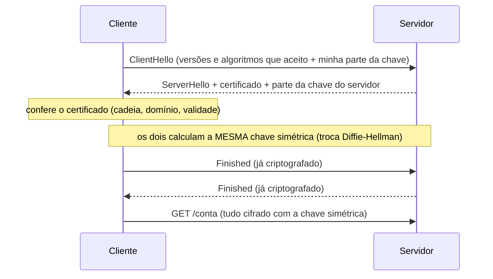

# 6.7 · SSL e TLS: o "S" do HTTPS

> **Em uma frase:** o **TLS** (sucessor do antigo SSL) cria um canal seguro entre cliente e servidor: confere o certificado do servidor, combina uma chave secreta e, a partir daí, criptografa tudo; o HTTPS é simplesmente o HTTP rodando dentro do TLS.

## 📖 De SSL para TLS

| Versão | Ano | Situação |
| --- | --- | --- |
| SSL 2.0 / 3.0 | 1995 / 1996 (Netscape) | ❌ Inseguras, proibidas |
| TLS 1.0 / 1.1 | 1999 / 2006 | ❌ Descontinuadas (2021) |
| **TLS 1.2** | 2008 | ✅ Ainda muito usada |
| **TLS 1.3** | 2018 | ✅ Atual: mais rápida e mais segura |

> [!NOTE]
> Por costume, todo mundo ainda fala "certificado SSL", mas o protocolo usado hoje é sempre o **TLS**.

## 🤝 O *handshake* do TLS (simplificado)



1. O cliente diz quais versões e algoritmos aceita.
2. O servidor escolhe, envia o **certificado** e sua parte da troca de chaves.
3. O cliente **valida o certificado** (aula [6.6](./06-criptografia-e-certificados.md)).
4. Os dois derivam a mesma **chave simétrica** sem nunca enviá-la pela rede.
5. Daí em diante, toda a comunicação é cifrada com essa chave (rápida, simétrica).

O TLS garante três coisas: **confidencialidade** (ninguém lê), **integridade** (ninguém altera sem ser percebido) e **autenticidade** (você está falando com o servidor certo).

> [!TIP]
> No TLS 1.3, o handshake leva só **uma ida e volta** (contra duas no 1.2), o que deixa o carregamento das páginas mais rápido.

## 🔐 Onde o TLS aparece

| Protocolo | Versão com TLS |
| --- | --- |
| HTTP | **HTTPS** (porta 443) |
| SMTP / IMAP / POP3 (e-mail) | SMTPS / IMAPS / POP3S |
| FTP | FTPS |
| WebSocket | **WSS** |

> [!IMPORTANT]
> Em produção, **toda** API deve usar HTTPS, especialmente as que trafegam senhas ou tokens. No Spring Boot, o HTTPS costuma ficar a cargo de um proxy (NGINX) ou do balanceador da nuvem, que repassa as requisições para a aplicação.

## 📌 Resumindo

- SSL é o nome antigo; o protocolo atual é o TLS (use 1.2 ou 1.3).
- O handshake valida o certificado e combina uma chave simétrica.
- TLS garante confidencialidade, integridade e autenticidade.
- HTTPS = HTTP + TLS.

## 🏋️ Mão na massa

**1.** Se o TLS usa criptografia assimétrica, por que os dados em si são cifrados com uma chave simétrica?

<details>
<summary>Ver resposta</summary>

Porque a criptografia simétrica é muito mais **rápida**. A parte assimétrica (e a troca Diffie-Hellman) serve só para autenticar o servidor e combinar a chave simétrica com segurança.

</details>

**2.** O navegador mostra "Sua conexão não é particular" em um site. Cite duas causas possíveis.

<details>
<summary>Ver resposta</summary>

Certificado **vencido**; certificado emitido para **outro domínio**; certificado **autoassinado** ou de uma AC em que o navegador não confia; ou o relógio do seu computador está errado.

</details>

**3.** Use o terminal para ver qual versão do TLS um site usa.

<details>
<summary>Ver resposta</summary>

```bash
curl -v https://www.google.com 2>&1 | grep -i "SSL connection"
# * SSL connection using TLSv1.3 / TLS_AES_256_GCM_SHA384
```

No DevTools do navegador, a aba **Security** mostra a mesma informação.

</details>

---

<div align="center">

[⬅️ 6.6 Criptografia e certificados digitais](./06-criptografia-e-certificados.md) &nbsp;|&nbsp; [🏠 Índice](../../README.md) &nbsp;|&nbsp; [6.8 WebSocket ➡️](./08-websocket.md)

</div>
