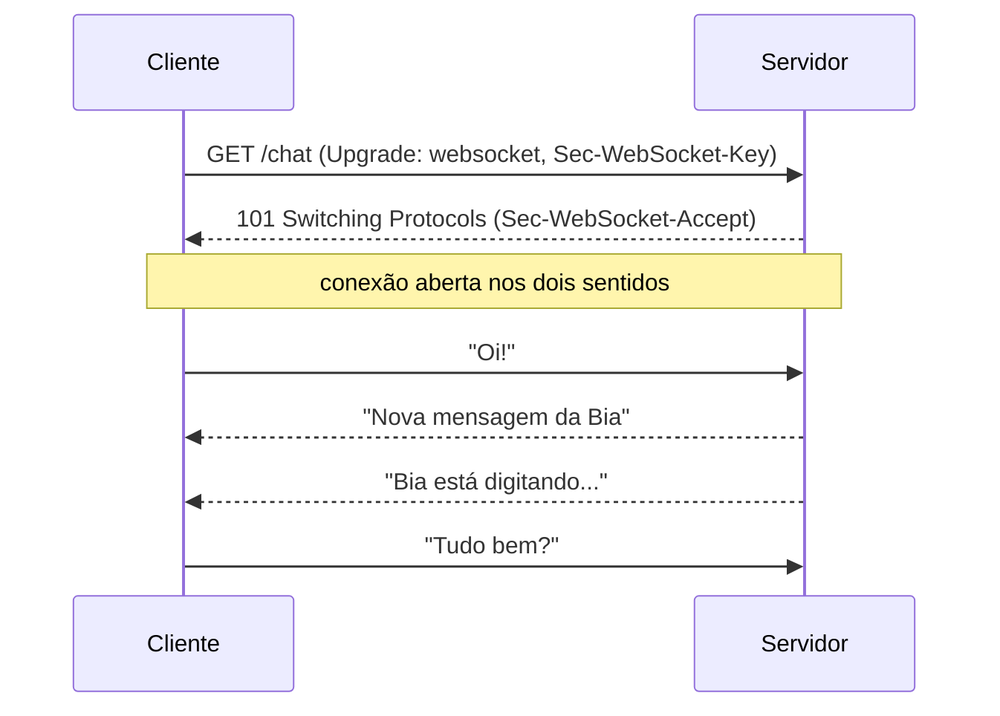

# 6.8 · WebSocket

> **Em uma frase:** o WebSocket abre uma conexão **permanente e bidirecional** entre cliente e servidor, permitindo que **os dois** mandem mensagens a qualquer momento, sem precisar de uma nova requisição a cada vez.

## 🔄 HTTP × WebSocket

No HTTP, a conversa é sempre **"pergunta e resposta"**: o servidor só fala quando o cliente pede. Para um chat, o cliente teria de ficar perguntando "tem mensagem nova?" o tempo todo (*polling*). No WebSocket, a "linha telefônica" fica aberta, e o servidor avisa assim que algo acontece.



1. A conexão **começa como HTTP**: o cliente pede um *upgrade* com os cabeçalhos `Upgrade: websocket` e uma chave aleatória (`Sec-WebSocket-Key`).
2. O servidor responde `101 Switching Protocols` com uma chave derivada da do cliente (`Sec-WebSocket-Accept`), confirmando que entende o protocolo.
3. A partir daí, a mesma conexão TCP é usada para trocar **mensagens** nos dois sentidos.

Padronizado em **2011** na RFC 6455, usa os esquemas `ws://` e `wss://` (com TLS).

| | HTTP | WebSocket |
| --- | --- | --- |
| Quem inicia | Sempre o cliente | Os dois, depois de conectados |
| Conexão | Uma requisição/resposta por vez | Permanente |
| Sobrecarga por mensagem | Cabeçalhos completos a cada requisição | Poucos bytes por mensagem |
| Latência | Maior (nova requisição a cada atualização) | Muito baixa |
| Ideal para | Páginas, APIs REST, arquivos | Chats, jogos, cotações, notificações em tempo real |

## ✅ Vantagens e cuidados

| ✅ Vantagens | ⚠️ Cuidados |
| --- | --- |
| Comunicação em tempo real nos dois sentidos | Cada conexão aberta consome recursos do servidor |
| Baixa latência e pouca sobrecarga | Proxies e firewalls antigos podem bloquear |
| Suportado por todos os navegadores modernos | O servidor precisa suportar o protocolo |
| | Segurança: use `wss://`, autentique a conexão e valide a origem (`Origin`) para evitar *cross-site WebSocket hijacking* |

> [!NOTE]
> O WebSocket em si **não** é "criptografia de ponta a ponta": a segurança vem do TLS do `wss://`, igual ao HTTPS.

> [!TIP]
> Se só o **servidor** precisa enviar atualizações (como um painel de cotações), o **Server-Sent Events (SSE)** é uma alternativa mais simples, que roda sobre HTTP comum. No Spring, WebSocket é suportado pelo módulo `spring-boot-starter-websocket` (geralmente com o protocolo STOMP).

### Exemplo no navegador

```javascript
const socket = new WebSocket("wss://exemplo.com/chat");

socket.onopen = () => socket.send("Olá, servidor!");
socket.onmessage = (evento) => console.log("Recebido:", evento.data);
socket.onclose = () => console.log("Conexão encerrada");
```

## 📌 Resumindo

- WebSocket = conexão permanente e bidirecional, iniciada com um *upgrade* HTTP (`101`).
- Ideal para tempo real: chats, jogos, cotações, notificações.
- Use `wss://`, autentique e valide a origem.

## 🏋️ Mão na massa

**1.** Para quais destes casos o WebSocket é a melhor escolha: (a) baixar um PDF; (b) placar de um jogo ao vivo; (c) cadastrar um cliente; (d) chat de atendimento?

<details>
<summary>Ver resposta</summary>

(b) e (d), que precisam de atualizações em tempo real. Para (a) e (c), HTTP comum é mais simples e adequado.

</details>

**2.** Qual código de status o servidor devolve ao aceitar uma conexão WebSocket?

<details>
<summary>Ver resposta</summary>

`101 Switching Protocols`.

</details>

**3.** Abra o DevTools (`F12` → **Network** → filtro **WS**) em um site com chat ou dados ao vivo e observe as mensagens trafegando.

<details>
<summary>Ver resposta</summary>

Ao clicar na conexão WebSocket, a aba **Messages** mostra cada mensagem enviada (seta para cima) e recebida (seta para baixo), sem que novas requisições HTTP apareçam na lista.

</details>

---

<div align="center">

[⬅️ 6.7 SSL e TLS](./07-tls.md) &nbsp;|&nbsp; [🏠 Índice](../../README.md) &nbsp;|&nbsp; [6.9 Conceitos de rede ➡️](./09-conceitos-de-rede.md)

</div>
