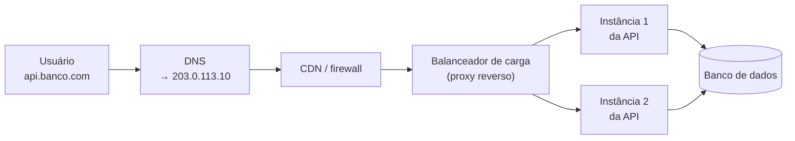
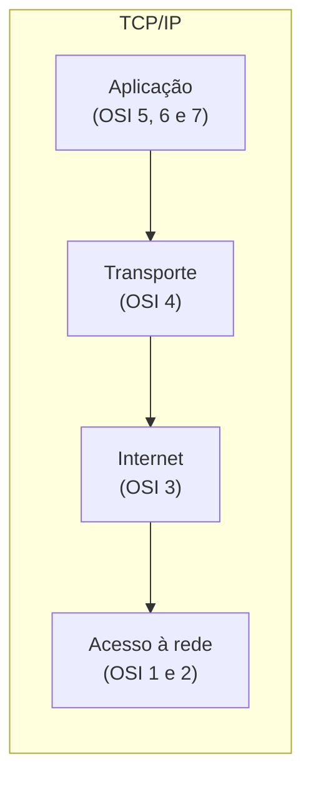

# 6.9 · Conceitos de rede: DNS, proxy reverso, balanceador, camadas OSI e TCP/IP

> **Em uma frase:** antes de uma requisição chegar à sua API, ela passa pelo **DNS** (que traduz o nome em IP), por **firewalls**, **CDNs**, **proxies reversos** e **balanceadores de carga**; os modelos **OSI** e **TCP/IP** organizam essa comunicação em camadas.

## 🗺️ O caminho de uma requisição



## 📖 Glossário essencial

| Conceito | O que é |
| --- | --- |
| **DNS** | O "catálogo telefônico" da internet: traduz nomes (`www.exemplo.com`) em endereços IP, consultando uma hierarquia de servidores. |
| **Socket** | Um ponto de comunicação identificado por **IP + porta** (ex.: `192.168.0.10:8080`). Pode ser TCP (confiável) ou UDP (rápido). |
| **Proxy (direto)** | Intermediário que age em nome do **cliente** (aula [6.3](./03-cookies-cache-proxy.md)). |
| **Proxy reverso** | Intermediário que age em nome do **servidor**: recebe as requisições, cuida do HTTPS e encaminha para as aplicações (NGINX, Traefik). |
| **Balanceador de carga** | Distribui as requisições entre várias instâncias, para escalar e tolerar falhas. |
| **Firewall** | Filtra o tráfego, permitindo só o autorizado. |
| **CDN** | Rede de servidores espalhados pelo mundo que guarda cópias do conteúdo perto dos usuários. |
| **API** | Conjunto de regras para um sistema conversar com outro (Módulo 6). |
| **Microsserviços** | Arquitetura que divide o sistema em serviços pequenos e independentes, cada um com seu deploy e, geralmente, seu banco. |
| **Contêineres** | Empacotam a aplicação com tudo o que ela precisa para rodar igual em qualquer lugar (Docker, no [módulo extra](../08-extras/03-docker-para-java.md)). |

### Tipos de balanceador de carga

| Tipo | Como decide |
| --- | --- |
| **Camada 4** (transporte) | Pelo IP e pela porta; rápido e simples. |
| **Camada 7** (aplicação) | Pelo conteúdo da requisição: caminho (`/api/pagamentos`), cabeçalhos, cookies. |
| **Por DNS** | Responde IPs diferentes para o mesmo nome. |
| Hardware × software | Equipamentos dedicados ou programas (NGINX, HAProxy, balanceadores da nuvem como o AWS ELB). |

## 🧱 Modelos em camadas

### OSI (7 camadas) × TCP/IP (4 camadas)

| OSI | TCP/IP | O que faz | Exemplos |
| --- | --- | --- | --- |
| 7. Aplicação | **Aplicação** | Protocolos usados pelos programas | HTTP, DNS, SMTP, WebSocket |
| 6. Apresentação | ↑ | Formato, codificação e criptografia dos dados | TLS, JSON, UTF-8 |
| 5. Sessão | ↑ | Abre, mantém e encerra sessões | — |
| 4. Transporte | **Transporte** | Entrega entre processos (portas) | TCP, UDP, QUIC |
| 3. Rede | **Internet** | Endereçamento e roteamento entre redes | IP, ICMP |
| 2. Enlace | **Acesso à rede** | Entrega dentro da mesma rede local | Ethernet, Wi-Fi, MAC |
| 1. Física | ↑ | Sinais elétricos, ópticos, de rádio | Cabos, fibra |



- O **OSI** é um modelo **de referência**: mais detalhado e didático.
- O **TCP/IP** é o modelo **que a internet usa de fato**.

> [!TIP]
> Quando alguém fala em "balanceador de camada 7" ou "firewall de camada 4", está usando a numeração do **OSI**.

## 📌 Resumindo

- DNS traduz nomes em IPs; sockets são IP + porta.
- Proxy reverso e balanceador ficam na frente das aplicações, distribuindo e protegendo.
- OSI tem 7 camadas (referência); TCP/IP tem 4 (o que a internet usa).

## 🏋️ Mão na massa

**1.** Use o terminal para descobrir o IP de `github.com`.

<details>
<summary>Ver resposta</summary>

```bash
nslookup github.com
# ou, no Linux/macOS/Git Bash:
dig github.com +short
```

O DNS devolve um ou mais endereços IP.

</details>

**2.** Em qual camada do TCP/IP ficam o HTTP, o TCP e o IP?

<details>
<summary>Ver resposta</summary>

HTTP na **Aplicação**, TCP no **Transporte** e IP na **Internet**.

</details>

**3.** Qual a diferença entre proxy e proxy reverso?

<details>
<summary>Ver resposta</summary>

O **proxy** (direto) fica do lado do **cliente** e acessa a internet em nome dele. O **proxy reverso** fica do lado do **servidor**: recebe as requisições da internet e as encaminha para as aplicações internas, que ficam "escondidas" atrás dele.

</details>

---

<div align="center">

[⬅️ 6.8 WebSocket](./08-websocket.md) &nbsp;|&nbsp; [🏠 Índice](../../README.md) &nbsp;|&nbsp; [6.10 Spring Framework ➡️](./10-spring-framework.md)

</div>
