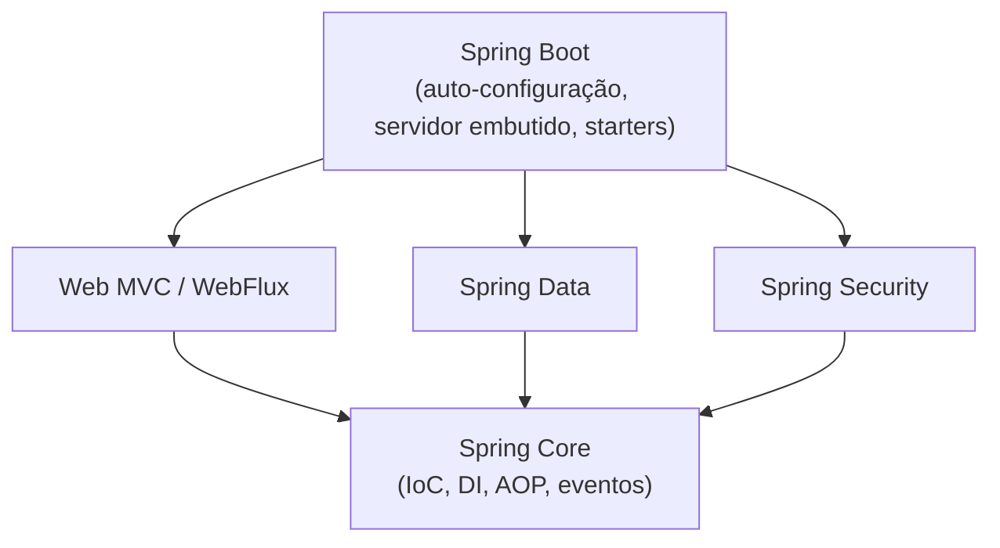

# 6.10 · Spring Framework: visão geral

> **Em uma frase:** o Spring é o framework mais usado para criar aplicações Java corporativas; ele **cria e conecta os objetos** da sua aplicação (inversão de controle) e oferece módulos prontos para web, dados, segurança, testes e muito mais.

## 📖 Origem

O Spring surgiu em **2003** (baseado no livro de **Rod Johnson** de 2002) como uma alternativa mais simples ao Java EE da época, que era pesado e cheio de configuração. Hoje é mantido pela **Broadcom** (que comprou a VMware) e é o padrão de mercado para back-end em Java, inclusive em bancos e fintechs.

| Versão | Ano | Base mínima |
| --- | --- | --- |
| Spring Framework 5 / Boot 2 | 2017–2018 | Java 8, pacotes `javax.*` |
| Spring Framework 6 / Boot 3 | 2022 | **Java 17**, pacotes `jakarta.*` |
| Spring Framework 7 / Boot 4 | 2025 | Java 17 (recomendado 21 ou 25), Jakarta EE 11 |

> [!IMPORTANT]
> Muitos tutoriais e projetos do curso usam o **Spring Boot 2** e imports `javax.persistence...`. A partir do Boot 3, esses pacotes viraram **`jakarta.persistence...`**, `jakarta.validation...` etc. Se copiar um exemplo antigo, troque `javax` por `jakarta`.

## ⭐ Principais ideias

| Recurso | O que oferece |
| --- | --- |
| **Inversão de controle (IoC)** | O Spring cria e gerencia os objetos (beans), em vez de você dar `new` em tudo. |
| **Injeção de dependências (DI)** | O Spring entrega a cada objeto as dependências de que ele precisa. Detalhes na [próxima aula](./11-ioc-di-e-beans.md). |
| **AOP** (programação orientada a aspectos) | Separa preocupações transversais (logs, transações, segurança) do código de negócio. |
| **Transações** | `@Transactional` abre e confirma (ou desfaz) transações automaticamente. |
| **Testabilidade** | Como as dependências são injetadas, é fácil trocá-las por *mocks* nos testes. |

## 🧩 O ecossistema

| Projeto/módulo | Para quê |
| --- | --- |
| **Spring Core** (IoC/DI, *beans*, *context*) | O coração do framework. |
| **Spring Web MVC** | APIs REST e aplicações web (`@RestController`). |
| **Spring WebFlux** | APIs reativas, não bloqueantes. |
| **Spring Data** (JPA, MongoDB, Redis...) | Acesso a dados com repositórios prontos, gerando as consultas para você. |
| **Spring Security** | Autenticação e autorização. |
| **Spring Boot** | Configuração automática, servidor embutido e *starters*. |
| **Spring Cloud** | Microsserviços: configuração centralizada, *service discovery*, clientes HTTP (OpenFeign)... |
| **Spring Batch** | Processamento de grandes volumes em lote. |

## ⚖️ Spring × Jakarta EE (antigo Java EE)

| | Jakarta EE | Spring |
| --- | --- | --- |
| O que é | Um conjunto de **especificações** (JPA, Servlet, CDI, Bean Validation...), implementadas por servidores como WildFly e Payara | Um **framework** (com implementação própria) |
| Onde roda | Normalmente num servidor de aplicação | Com o Boot, num `.jar` com servidor embutido |
| Relação | — | **Usa** várias especificações Jakarta (Servlet, JPA, Validation) por baixo |

> [!NOTE]
> Não é "um ou outro": uma aplicação Spring Boot com JPA usa as especificações do Jakarta EE. A diferença é a forma de montar e configurar a aplicação. Em ambos, a configuração hoje é feita principalmente com **anotações**.

## 📌 Resumindo

- Spring = framework Java mais usado no mercado, baseado em IoC e DI.
- Ecossistema: Core, Web, Data, Security, Boot, Cloud, Batch...
- Boot 3+ exige Java 17 e usa `jakarta.*` no lugar de `javax.*`.

## 🏋️ Mão na massa

**1.** Um tutorial usa `import javax.persistence.Entity;`, mas seu projeto Spring Boot 3 não compila. O que fazer?

Ver resposta

Trocar para `import jakarta.persistence.Entity;`. Desde o Spring Boot 3, as especificações migraram do pacote `javax` para `jakarta`.

**2.** Qual módulo do Spring você usaria para: (a) criar uma API REST; (b) acessar o PostgreSQL sem escrever SQL para o CRUD; (c) exigir login?

Ver resposta

(a) **Spring Web MVC** (`spring-boot-starter-web`); (b) **Spring Data JPA** (`spring-boot-starter-data-jpa`); (c) **Spring Security** (`spring-boot-starter-security`).

**3.** O que significa dizer que o Spring faz "inversão de controle"?

Ver resposta

Que o **controle** da criação e da ligação dos objetos sai do seu código e passa para o **framework**: em vez de você instanciar as dependências com `new`, o Spring cria os objetos e os entrega prontos.

---

[⬅️ 6.9 Conceitos de rede](./09-conceitos-de-rede.md) &nbsp;|&nbsp; [🏠 Índice](../../README.md) &nbsp;|&nbsp; [6.11 IoC, injeção de dependências, beans e escopos ➡️](./11-ioc-di-e-beans.md)

