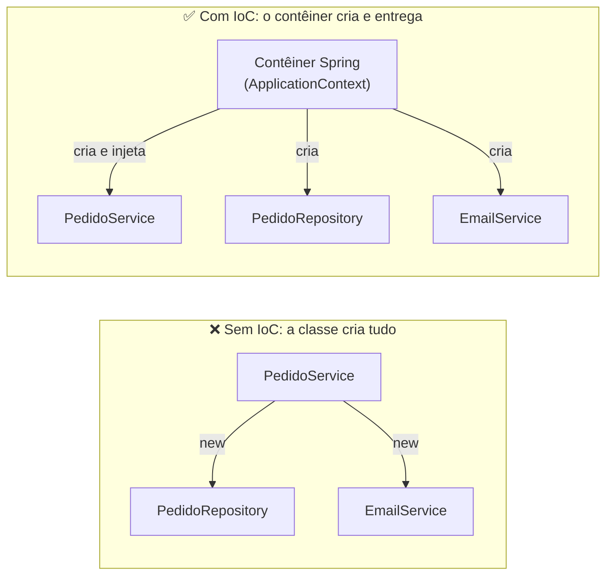

# 6.11 · IoC, injeção de dependências, beans e escopos

> **Em uma frase:** em vez de cada classe criar suas dependências com `new`, o **contêiner do Spring** cria os objetos (**beans**) e os **injeta** onde forem necessários; o **escopo** define quantas instâncias de cada bean existem.

## 🔄 Inversão de controle (IoC)



```java
// ❌ Acoplado: difícil de testar e de trocar o EmailService
public class PedidoService {
    private final EmailService email = new EmailService();
}

// ✅ Desacoplado: a dependência chega de fora
@Service
public class PedidoService {
    private final EmailService email;

    public PedidoService(EmailService email) {   // o Spring injeta aqui
        this.email = email;
    }
}
```

> [!TIP]
> **Analogia:** sem IoC, você cozinha e vai ao mercado comprar cada ingrediente. Com IoC, é como um restaurante: você (a classe) só diz o que precisa, e a cozinha (o contêiner) entrega tudo pronto.

O contêiner do Spring é o **`ApplicationContext`** (uma especialização da interface `BeanFactory`). Ele lê a configuração, cria os beans (usando *reflection*), resolve as dependências e controla o ciclo de vida de cada um.

## 🫘 Beans

Um **bean** é qualquer objeto **criado e gerenciado pelo Spring**. Há duas formas principais de declarar:

### 1. Anotando a classe (*stereotypes*)

| Anotação | Uso |
| --- | --- |
| `@Component` | Componente genérico |
| `@Service` | Regras de negócio |
| `@Repository` | Acesso a dados (também traduz exceções do banco) |
| `@Controller` / `@RestController` | Recebe requisições web |
| `@Configuration` | Classe que declara beans com `@Bean` |

O Spring encontra essas classes automaticamente (*component scan*) no pacote da classe principal e nos subpacotes.

### 2. Com `@Bean`, dentro de uma `@Configuration`

Use quando **não** pode anotar a classe (ela é de uma biblioteca) ou quando a criação exige lógica:

```java
@Configuration
public class AppConfig {

    @Bean
    public Gson gson() {                     // Gson é de uma biblioteca externa
        return new GsonBuilder().setPrettyPrinting().create();
    }
}
```

> [!NOTE]
> Regra prática: **`@Component` (e derivadas) nas suas classes**; **`@Bean` para objetos de terceiros** ou que precisam de configuração na criação.

## 💉 Formas de injeção

```java
@Service
public class RelatorioService {

    // ✅ 1. Por CONSTRUTOR (recomendada)
    private final VendaRepository vendas;
    public RelatorioService(VendaRepository vendas) {
        this.vendas = vendas;          // com um só construtor, nem precisa de @Autowired
    }

    // 2. Por SETTER (para dependências opcionais)
    private Notificador notificador;
    @Autowired(required = false)
    public void setNotificador(Notificador notificador) { this.notificador = notificador; }

    // ⚠️ 3. Por ATRIBUTO (comum em tutoriais, mas evite)
    @Autowired
    private Clock relogio;
}
```

> [!IMPORTANT]
> Prefira a injeção por **construtor**: as dependências ficam `final` (imutáveis), obrigatórias e explícitas, e a classe pode ser testada com `new RelatorioService(mockDoRepositorio)` sem o Spring.

### Como o `@Autowired` escolhe o bean

1. Procura um bean **do tipo** pedido (*by type*).
2. Se houver **mais de um** do mesmo tipo, tenta desempatar pelo **nome** do parâmetro/atributo.
3. Se ainda houver ambiguidade, a aplicação não sobe (`NoUniqueBeanDefinitionException`). Resolva com:

```java
@Component("pix")    class PagamentoPix implements Pagamento { }
@Component("boleto") class PagamentoBoleto implements Pagamento { }

@Service
class CheckoutService {
    private final Pagamento pagamento;

    CheckoutService(@Qualifier("pix") Pagamento pagamento) {   // escolhe pelo nome
        this.pagamento = pagamento;
    }
}
```

Outra opção é marcar uma das implementações com `@Primary` (a escolhida por padrão). E se você quiser **todas**, injete uma lista: `List<Pagamento> pagamentos`.

## 🔭 Escopos

| Escopo | Quantas instâncias | Uso típico |
| --- | --- | --- |
| **`singleton`** (padrão) | **Uma** para toda a aplicação | Services, repositories, controllers |
| `prototype` | Uma **nova a cada** vez que é pedida | Objetos com estado temporário |
| `request` | Uma por **requisição HTTP** | Dados da requisição atual |
| `session` | Uma por **sessão** de usuário | Carrinho de compras em apps com sessão |
| `application` | Uma por `ServletContext` | Raro |
| `websocket` | Uma por sessão WebSocket | Raro |

```java
@Component
@Scope("prototype")
public class GeradorDeProtocolo { ... }
```

> [!WARNING]
> Como um bean `singleton` é compartilhado por **todas** as requisições ao mesmo tempo, ele **não deve guardar estado** de um usuário em atributos (ex.: `private Cliente clienteAtual;`). Isso causaria mistura de dados entre usuários.

> [!NOTE]
> O escopo "*global session*", citado em materiais antigos, existia só para *portlets* e foi removido no Spring 5.

## ⚙️ Configurações externas: `@Value` e `@ConfigurationProperties`

```properties
# application.properties
app.nome=Banco Pan API
remetente.email=contato@banco.com
remetente.telefones=1199990000,1188880000
```

```java
@Component
public class Saudacao {
    @Value("${app.nome}")
    private String nomeApp;

    @Value("${app.versao:1.0}")          // valor padrão se a chave não existir
    private String versao;
}

@ConfigurationProperties(prefix = "remetente")
public record Remetente(String email, List<Long> telefones) { }
// habilite com @EnableConfigurationProperties(Remetente.class) ou @ConfigurationPropertiesScan
```

## 📌 Resumindo

- IoC: o contêiner (`ApplicationContext`) cria e conecta os objetos.
- Beans: `@Component`/`@Service`/`@Repository`/`@RestController` nas suas classes; `@Bean` para objetos de terceiros.
- Injete por **construtor**; resolva ambiguidades com `@Qualifier` ou `@Primary`.
- Escopo padrão é `singleton`: não guarde estado de usuário nele.
- `@Value` e `@ConfigurationProperties` leem o `application.properties`.

## 🏋️ Mão na massa

**1.** Reescreva esta classe usando injeção por construtor:

```java
@Service
public class CadastroService {
    @Autowired
    private ClienteRepository repository;
}
```

<details>
<summary>Ver resposta</summary>

```java
@Service
public class CadastroService {
    private final ClienteRepository repository;

    public CadastroService(ClienteRepository repository) {
        this.repository = repository;
    }
}
```

(Com o Lombok, `@RequiredArgsConstructor` gera esse construtor automaticamente.)

</details>

**2.** Duas classes implementam a interface `Notificador` (`EmailNotificador` e `SmsNotificador`). A aplicação não sobe ao injetar `Notificador`. Por quê, e como resolver?

<details>
<summary>Ver resposta</summary>

O Spring encontrou **dois beans** do mesmo tipo e não sabe qual injetar. Soluções: marcar um com `@Primary`, usar `@Qualifier("nomeDoBean")` no ponto de injeção, ou injetar `List<Notificador>` se precisar de todos.

</details>

**3.** Crie um bean `prototype` e mostre que cada injeção recebe uma instância diferente.

<details>
<summary>Ver resposta</summary>

```java
@Component
@Scope("prototype")
class Contador { }

@SpringBootApplication
public class App implements CommandLineRunner {
    private final ApplicationContext contexto;
    App(ApplicationContext contexto) { this.contexto = contexto; }

    public static void main(String[] args) { SpringApplication.run(App.class, args); }

    @Override
    public void run(String... args) {
        Contador a = contexto.getBean(Contador.class);
        Contador b = contexto.getBean(Contador.class);
        System.out.println(a == b);   // false (com singleton seria true)
    }
}
```

</details>

📂 Os projetos do curso sobre esses temas estão em [`projetos/06-spring-boot-dio`](../../projetos/06-spring-boot-dio/) (`spring-ioc-di-beans-autowired`, `spring-scopes-singleton-prototype`, `spring-properties-value` e `spring-configuration-properties`).

---

<div align="center">

[⬅️ 6.10 Spring Framework](./10-spring-framework.md) &nbsp;|&nbsp; [🏠 Índice](../../README.md) &nbsp;|&nbsp; [6.12 Spring Boot ➡️](./12-spring-boot.md)

</div>
