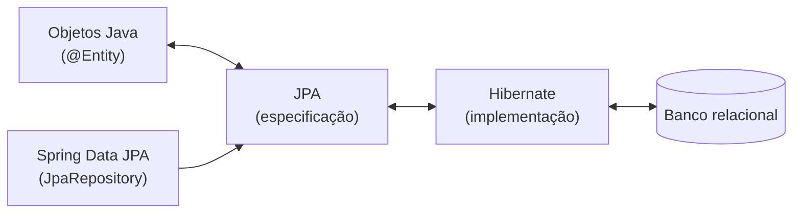

# 6.13 · Projeto prático: primeiros passos, beans, escopos, propriedades e JPA

> **Em uma frase:** uma sequência de mini-projetos para ver na prática o `CommandLineRunner`, `@Bean` × `@Component`, escopos, `@Value`, `@ConfigurationProperties` e, por fim, o mapeamento de entidades com JPA.

📂 Meus projetos desta parte: [`projetos/06-spring-boot-dio`](../../projetos/06-spring-boot-dio/) · Referências: [Spring Initializr](https://start.spring.io/) · [Documentação do Spring Data JPA](https://docs.spring.io/spring-data/jpa/reference/)

> [!NOTE]
> Os projetos do curso foram feitos com o Spring Boot 2. A ideia de cada um continua válida; ao recriá-los com o Boot 3 ou 4, lembre de trocar `javax.*` por `jakarta.*`.

## 1️⃣ Primeiros passos (`spring-primeiros-passos`)

O `CommandLineRunner` executa um código assim que a aplicação sobe, ótimo para testes rápidos:

```java
@Component
public class MeuPrimeiroRunner implements CommandLineRunner {

    private final Calculadora calculadora;     // injetada pelo Spring

    public MeuPrimeiroRunner(Calculadora calculadora) {
        this.calculadora = calculadora;
    }

    @Override
    public void run(String... args) {
        System.out.println("Resultado: " + calculadora.somar(2, 7));
    }
}

@Component
class Calculadora {
    int somar(int a, int b) { return a + b; }
}
```

## 2️⃣ `@Bean` × `@Component` (`spring-ioc-di-beans-autowired`)

- **`@Component`**: nas **suas** classes.
- **`@Bean`**: num método de uma classe `@Configuration`, para objetos de **bibliotecas** (que você não pode anotar), como o `Gson`.

Detalhes na aula [6.11](./11-ioc-di-e-beans.md).

## 3️⃣ Escopos (`spring-scopes-singleton-prototype`)

Com o padrão `singleton`, alterar um atributo de um bean afeta **todos** os lugares que o usam. Com `prototype`, cada injeção recebe um objeto novo:

```java
@Configuration
public class RemetenteConfig {
    @Bean
    @Scope("prototype")         // tire esta linha e veja os dois "remetentes" mudarem juntos
    public Remetente remetente() {
        Remetente r = new Remetente();
        r.setEmail("noreply@dio.com.br");
        return r;
    }
}
```

## 4️⃣ `@Value` (`spring-properties-value`)

```properties
remetente.nome=DIO
remetente.telefones=11956781254,11956781254
```

```java
@Value("${remetente.nome}")
private String nome;

@Value("${remetente.email:noreply@dio.com.br}")   // valor padrão se a chave não existir
private String email;

@Value("${remetente.telefones}")
private List<Long> telefones;
```

## 5️⃣ `@ConfigurationProperties` (`spring-configuration-properties`)

Quando há várias propriedades com o mesmo prefixo, agrupe-as numa classe:

```java
@ConfigurationProperties(prefix = "remetente")
public record Remetente(String nome, String email, List<Long> telefones) { }
```

```java
@SpringBootApplication
@ConfigurationPropertiesScan         // encontra as classes @ConfigurationProperties
public class App { ... }
```

## 6️⃣ ORM e JPA (`dio-spring-data-jpa`)

**ORM** (*Object-Relational Mapping*) é a técnica de mapear **classes Java ↔ tabelas** do banco. A **JPA** (*Jakarta Persistence API*) é a especificação desse mapeamento; o **Hibernate** é a implementação mais usada; e o **Spring Data JPA** simplifica tudo com repositórios prontos.



| Implementações de JPA | Observação |
| --- | --- |
| **Hibernate** | A padrão do Spring Boot |
| EclipseLink | Implementação de referência |
| OpenJPA, TopLink | Menos usadas |

```java
@Entity
@Table(name = "usuarios")
public class Usuario {
    @Id
    @GeneratedValue(strategy = GenerationType.IDENTITY)
    private Integer id;

    @Column(length = 50, nullable = false)
    private String nome;

    @Column(length = 20, nullable = false, unique = true)
    private String login;

    // getters, setters
}

public interface UsuarioRepository extends JpaRepository<Usuario, Integer> {
    List<Usuario> findByNomeContainingIgnoreCase(String nome);   // a consulta é gerada pelo nome do método!
}
```

O `EntityManager` é o objeto da JPA que de fato salva, busca e remove entidades. O `JpaRepository` usa um `EntityManager` por baixo e já oferece `save`, `findById`, `findAll`, `deleteById`, paginação e mais. O mapeamento JPA é aprofundado na aula [6.25](./25-spring-data-jpa.md).

## 📌 Resumindo

- `CommandLineRunner` roda código assim que a aplicação sobe.
- `@Component` nas suas classes, `@Bean` para objetos de bibliotecas.
- `singleton` (padrão) × `prototype`; `@Value` e `@ConfigurationProperties` leem configurações.
- ORM mapeia classes em tabelas; JPA (especificação) + Hibernate (implementação) + Spring Data JPA (repositórios).

## 🏋️ Mão na massa

**1.** Crie um `CommandLineRunner` que imprima o valor da propriedade `app.mensagem` do `application.properties`.

<details>
<summary>Ver resposta</summary>

```properties
app.mensagem=Aplicação no ar!
```

```java
@Component
public class Inicio implements CommandLineRunner {
    @Value("${app.mensagem}")
    private String mensagem;

    @Override
    public void run(String... args) {
        System.out.println(mensagem);
    }
}
```

</details>

**2.** Usando o `UsuarioRepository`, salve dois usuários e liste os que têm "an" no nome.

<details>
<summary>Ver resposta</summary>

```java
@Component
public class StartApp implements CommandLineRunner {
    private final UsuarioRepository repository;
    StartApp(UsuarioRepository repository) { this.repository = repository; }

    @Override
    public void run(String... args) {
        Usuario ana = new Usuario(); ana.setNome("Ana"); ana.setLogin("ana");
        Usuario bia = new Usuario(); bia.setNome("Bia"); bia.setLogin("bia");
        repository.saveAll(List.of(ana, bia));

        repository.findByNomeContainingIgnoreCase("an").forEach(u -> System.out.println(u.getNome()));   // Ana
    }
}
```

Para testar sem instalar um banco, adicione a dependência `com.h2database:h2` (banco em memória).

</details>

**3.** Qual a diferença entre JPA e Hibernate?

<details>
<summary>Ver resposta</summary>

A **JPA** é a **especificação** (as interfaces e anotações, como `@Entity` e `EntityManager`). O **Hibernate** é uma **implementação** dessa especificação, que faz o trabalho de fato.

</details>

---

<div align="center">

[⬅️ 6.12 Spring Boot](./12-spring-boot.md) &nbsp;|&nbsp; [🏠 Índice](../../README.md) &nbsp;|&nbsp; [6.14 REST e APIs RESTful ➡️](./14-rest.md)

</div>
