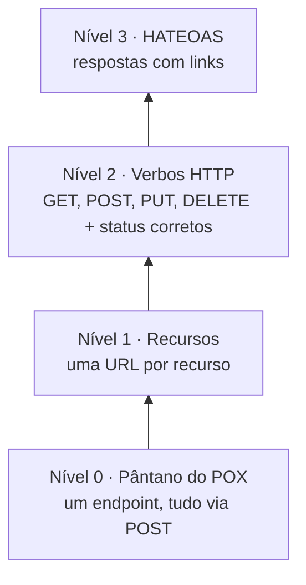

# 6.14 · REST e APIs RESTful

> **Em uma frase:** REST é um **estilo de arquitetura** para APIs web em que tudo é um **recurso** identificado por uma URL, manipulado pelos **verbos HTTP** (GET, POST, PUT, DELETE) e representado geralmente em **JSON**.

## 📖 O que é REST

**REST** (*Representational State Transfer*) foi descrito por **Roy Fielding** em sua tese de doutorado, em **2000**. Uma API que segue esses princípios é chamada de **RESTful**.

```text
GET    /clientes          → lista os clientes
GET    /clientes/42       → busca o cliente 42
POST   /clientes          → cria um cliente (dados no corpo)
PUT    /clientes/42       → substitui o cliente 42
PATCH  /clientes/42       → altera parte do cliente 42
DELETE /clientes/42       → remove o cliente 42
```

### As restrições (*constraints*) do REST

| Restrição | Significa |
| --- | --- |
| **Cliente-servidor** | Interface (cliente) e dados (servidor) evoluem separadamente. |
| **Sem estado** (*stateless*) | Cada requisição leva tudo o que é necessário (ex.: o token); o servidor não guarda sessão. |
| **Cache** | As respostas dizem se podem ser guardadas em cache. |
| **Interface uniforme** | Recursos identificados por URLs, manipulados por representações (JSON), mensagens autodescritivas e **HATEOAS**. |
| **Sistema em camadas** | O cliente não sabe (nem precisa saber) se fala com o servidor final ou com um proxy, cache ou balanceador no caminho. |
| **Código sob demanda** (opcional) | O servidor pode enviar código para o cliente executar (ex.: JavaScript). |

### REST × RESTful

Na prática, os termos são usados como sinônimos. Os puristas dizem que "RESTful" é a API que segue **todas** as restrições, incluindo o HATEOAS, enquanto muitas APIs "REST" do mercado seguem só parte delas.

### Boas práticas de URLs

- Use **substantivos no plural** para recursos: `/clientes`, não `/getClientes`.
- A **ação** fica no verbo HTTP, não na URL.
- Hierarquia para relações: `/clientes/42/pedidos`.
- Filtros e paginação na *query string*: `/pedidos?status=pago&page=0&size=20`.
- Devolva os **códigos de status** corretos (aula [6.2](./02-mensagens-http.md)).

## 🪜 Modelo de maturidade de Richardson

Leonard Richardson propôs 4 níveis para avaliar o quanto uma API é RESTful:



### Nível 0: sem regras

Um único endpoint (ou vários sem padrão), tudo com `POST`. HTTP usado só como "túnel":

| Verbo | URL | Operação |
| --- | --- | --- |
| POST | `/getUsuario` | Pesquisar |
| POST | `/salvarUsuario` | Salvar |
| POST | `/alterarUsuario` | Alterar |
| POST | `/excluirUsuario` | Excluir |

### Nível 1: recursos

Cada recurso ganha sua URL, mas os verbos ainda não são usados corretamente (tudo continua com `POST`):

| Verbo | URL | Operação |
| --- | --- | --- |
| POST | `/usuarios/1` | Pesquisar |
| POST | `/usuarios` | Salvar |
| POST | `/usuarios/1/alterar` | Alterar |
| POST | `/usuarios/1/excluir` | Excluir |

### Nível 2: verbos HTTP

Recursos + verbos com o significado correto + códigos de status. **É onde está a maioria das APIs do mercado.**

| Verbo | URL | Operação | Status de sucesso |
| --- | --- | --- | --- |
| GET | `/usuarios/1` | Pesquisar | 200 |
| POST | `/usuarios` | Salvar | 201 |
| PUT | `/usuarios/1` | Alterar | 200 ou 204 |
| DELETE | `/usuarios/1` | Excluir | 204 |

### Nível 3: HATEOAS

*Hypermedia As The Engine Of Application State*: a resposta traz **links** para as próximas ações possíveis, como uma página web traz links para outras páginas.

```json
{
  "id": 1234,
  "nome": "John Doe",
  "email": "john.doe@example.com",
  "_links": {
    "self":     { "href": "/usuarios/1234" },
    "pedidos":  { "href": "/usuarios/1234/pedidos" },
    "endereco": { "href": "/usuarios/1234/endereco" }
  }
}
```

> [!NOTE]
> O nível 3 é o menos adotado. No Spring, ele é implementado com o projeto **Spring HATEOAS** (usado no projeto da aula [6.24](./24-amazon-rds.md)).

## 📌 Resumindo

- REST: recursos com URLs, verbos HTTP, representações (JSON) e comunicação sem estado.
- URLs com substantivos no plural; a ação fica no verbo.
- Maturidade de Richardson: 0 (POX) → 1 (recursos) → 2 (verbos + status) → 3 (HATEOAS).

## 🏋️ Mão na massa

**1.** Reescreva estes endpoints no estilo REST: `POST /cadastrarProduto`, `GET /listarProdutos`, `POST /deletarProduto?id=5`.

<details>
<summary>Ver resposta</summary>

`POST /produtos`, `GET /produtos` e `DELETE /produtos/5`.

</details>

**2.** Em que nível de maturidade está uma API que usa `GET /pedidos/10` e `DELETE /pedidos/10`, devolve `404` quando o pedido não existe, mas não retorna links?

<details>
<summary>Ver resposta</summary>

**Nível 2**: usa recursos, verbos e status corretamente, mas não tem HATEOAS (nível 3).

</details>

**3.** Desenhe as rotas de uma API de contas bancárias: criar conta, consultar, listar as transações de uma conta e registrar um depósito.

<details>
<summary>Ver resposta</summary>

```text
POST /contas                       → cria a conta
GET  /contas/{id}                  → consulta a conta
GET  /contas/{id}/transacoes       → lista as transações
POST /contas/{id}/depositos        → registra um depósito (cria um recurso "depósito")
```

Ações de negócio, como depositar, costumam ser modeladas como a **criação** de um recurso (o depósito), em vez de um verbo na URL.

</details>

---

<div align="center">

[⬅️ 6.13 Primeiros passos, beans, escopos, propriedades e JPA](./13-projeto-spring-boot.md) &nbsp;|&nbsp; [🏠 Índice](../../README.md) &nbsp;|&nbsp; [6.15 @RestController ➡️](./15-rest-controller.md)

</div>
