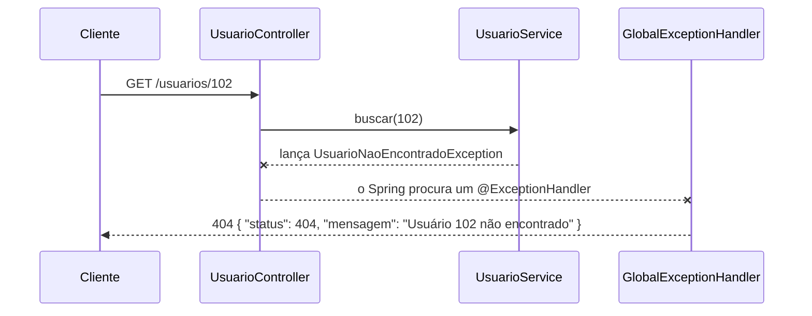

# 6.17 · Tratamento de erros na API: `@RestControllerAdvice`

> **Em uma frase:** em vez de espalhar `try/catch` pelos controllers, você cria **uma** classe `@RestControllerAdvice` com métodos `@ExceptionHandler` que transformam cada exceção numa resposta HTTP clara (status correto + mensagem amigável).

## 🤔 O problema

Sem tratamento, uma exceção vira um `500 Internal Server Error` genérico, às vezes com detalhes internos do sistema (o que é ruim para quem consome a API **e** um risco de segurança).

## 🛡️ A solução: um tratador global



### 1. Exceções de negócio

```java
public class UsuarioNaoEncontradoException extends RuntimeException {
    public UsuarioNaoEncontradoException(Long id) {
        super("Usuário " + id + " não encontrado");
    }
}

public class RegraDeNegocioException extends RuntimeException {
    public RegraDeNegocioException(String mensagem) { super(mensagem); }
}
```

### 2. O formato da resposta de erro

```java
public record ErroResponse(int status, String mensagem, Instant momento) {
    public ErroResponse(HttpStatus status, String mensagem) {
        this(status.value(), mensagem, Instant.now());
    }
}
```

### 3. O tratador global

```java
@RestControllerAdvice
public class GlobalExceptionHandler {

    @ExceptionHandler(UsuarioNaoEncontradoException.class)
    @ResponseStatus(HttpStatus.NOT_FOUND)
    public ErroResponse naoEncontrado(UsuarioNaoEncontradoException e) {
        return new ErroResponse(HttpStatus.NOT_FOUND, e.getMessage());
    }

    @ExceptionHandler(RegraDeNegocioException.class)
    @ResponseStatus(HttpStatus.UNPROCESSABLE_ENTITY)
    public ErroResponse regraDeNegocio(RegraDeNegocioException e) {
        return new ErroResponse(HttpStatus.UNPROCESSABLE_ENTITY, e.getMessage());
    }

    @ExceptionHandler(MethodArgumentNotValidException.class)    // erros do @Valid
    @ResponseStatus(HttpStatus.BAD_REQUEST)
    public ErroResponse validacao(MethodArgumentNotValidException e) {
        String campos = e.getBindingResult().getFieldErrors().stream()
                .map(erro -> erro.getField() + ": " + erro.getDefaultMessage())
                .collect(Collectors.joining("; "));
        return new ErroResponse(HttpStatus.BAD_REQUEST, campos);
    }

    @ExceptionHandler(Exception.class)                           // qualquer outra coisa
    @ResponseStatus(HttpStatus.INTERNAL_SERVER_ERROR)
    public ErroResponse inesperado(Exception e) {
        // registre o erro completo no log aqui
        return new ErroResponse(HttpStatus.INTERNAL_SERVER_ERROR,
                "Ocorreu um erro inesperado. Tente novamente mais tarde.");
    }
}
```

O service só **lança** a exceção; o controller nem precisa saber que ela existe:

```java
public Usuario buscar(Long id) {
    return repository.findById(id).orElseThrow(() -> new UsuarioNaoEncontradoException(id));
}
```

> [!TIP]
> O Spring 6+ suporta o padrão **Problem Details** (RFC 9457), um formato oficial para erros em APIs. Basta retornar `ProblemDetail.forStatusAndDetail(HttpStatus.NOT_FOUND, e.getMessage())` no handler, ou ligar `spring.mvc.problemdetails.enabled=true`.

> [!WARNING]
> Nunca devolva o *stack trace* ou mensagens internas (como erros de SQL) para o cliente. Registre-os no **log** e responda com uma mensagem genérica.

## ✅ Vantagens

- Tratamento **centralizado**: um lugar só para todas as exceções.
- Respostas **padronizadas**, com o status HTTP correto.
- Controllers e services mais limpos.
- Não expõe detalhes internos.

## 📌 Resumindo

- `@RestControllerAdvice` + `@ExceptionHandler(Tipo.class)` tratam exceções de toda a API.
- Cada exceção vira um status HTTP adequado (404, 422, 400, 500...).
- `MethodArgumentNotValidException` captura os erros do `@Valid`.
- Considere o formato padrão `ProblemDetail`.

## 🏋️ Mão na massa

**1.** Crie uma exceção `CampoObrigatorioException` e um handler que a transforme em `400 Bad Request`.

<details>
<summary>Ver resposta</summary>

```java
public class CampoObrigatorioException extends RuntimeException {
    public CampoObrigatorioException(String campo) {
        super("O campo '" + campo + "' é obrigatório");
    }
}

// dentro do GlobalExceptionHandler:
@ExceptionHandler(CampoObrigatorioException.class)
@ResponseStatus(HttpStatus.BAD_REQUEST)
public ErroResponse campoObrigatorio(CampoObrigatorioException e) {
    return new ErroResponse(HttpStatus.BAD_REQUEST, e.getMessage());
}
```

</details>

**2.** Por que o handler de `Exception.class` não devolve `e.getMessage()` para o cliente?

<details>
<summary>Ver resposta</summary>

Porque uma exceção inesperada pode conter detalhes internos (nomes de tabelas, consultas SQL, caminhos de arquivos), que ajudariam um atacante e confundiriam o usuário. O certo é registrar o erro completo no log e responder algo genérico.

</details>

**3.** Se existirem handlers para `RuntimeException` e para `UsuarioNaoEncontradoException` (filha dela), qual é usado ao lançar a segunda?

<details>
<summary>Ver resposta</summary>

O **mais específico**: o de `UsuarioNaoEncontradoException`. O Spring escolhe o handler cujo tipo é o mais próximo da exceção lançada.

</details>

---

<div align="center">

[⬅️ 6.16 Documentando a API com OpenAPI e Swagger](./16-openapi-swagger.md) &nbsp;|&nbsp; [🏠 Índice](../../README.md) &nbsp;|&nbsp; [6.18 Minha primeira API REST documentada ➡️](./18-projeto-rest-api.md)

</div>
