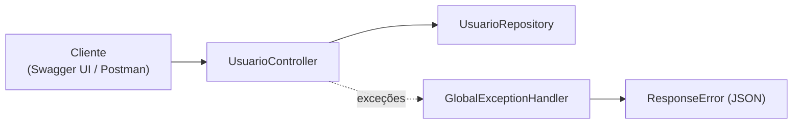

# 6.18 · Projeto: minha primeira API REST documentada

> **Em uma frase:** juntando as aulas anteriores, criamos uma API REST de usuários com Spring Web, documentação no Swagger e tratamento global de exceções.

📂 Meu projeto: [`projetos/06-api-com-swagger`](../../projetos/06-api-com-swagger/) · Exemplos do curso: [`projetos/06-spring-boot-dio`](../../projetos/06-spring-boot-dio/) (`springboot-web`, `springboot-web-swagger` e `dio-spring-data-jpa-exception-handler`)

## 🎯 O que o projeto tem

- Projeto web criado no Spring Initializr.
- Controllers REST (`WelcomeController`, `UsuarioController`).
- Um repositório simulado (`UsuarioRepository`).
- Documentação com Swagger.
- Exceções de negócio (`BusinessException`, `CampoObrigatorioException`) tratadas num `GlobalExceptionHandler`, que devolve um `ResponseError` padronizado.



## ⚠️ O problema das dependências do Swagger

Durante o curso, a combinação **Spring Boot 2.6+ com Springfox 3** quebrava na inicialização com o erro `Failed to start bean 'documentationPluginsBootstrapper'`. Para contornar, foi preciso misturar versões no `pom.xml` (com ajuda deste [vídeo](https://www.youtube.com/watch?v=pMXnR1T47e0) e desta [issue](https://github.com/digitalinnovationone/dio-springboot/issues/2)).

> [!TIP]
> **Como fazer hoje:** em vez do Springfox, use o **springdoc-openapi** (aula [6.16](./16-openapi-swagger.md)). Com o Spring Boot 3, basta a dependência `springdoc-openapi-starter-webmvc-ui` e nenhuma classe de configuração. O Swagger UI fica em `/swagger-ui/index.html`.

## 🔄 Recriando o projeto com as versões atuais

1. Gere no [start.spring.io](https://start.spring.io/) um projeto com **Spring Web** e **Validation** (Java 21).
2. Adicione o `springdoc-openapi-starter-webmvc-ui`.
3. Copie as classes `model`, `controller` e `handler` do projeto original.
4. Troque imports `javax.*` por `jakarta.*` e apague a classe `SwaggerConfig` do Springfox.
5. Rode e teste pelo Swagger UI.

## 📌 Resumindo

- O projeto aplica controllers REST, documentação e tratamento global de erros.
- O Springfox causou incompatibilidades; hoje use o springdoc.
- Para atualizar um projeto do curso: novo projeto no Initializr, springdoc, `javax` → `jakarta`.

## 🏋️ Mão na massa

**1.** Siga os passos de "Recriando o projeto" e faça a API subir com o Spring Boot 3 (ou 4).

<details>
<summary>Ver resposta</summary>

Se tudo estiver certo, `./mvnw spring-boot:run` sobe sem erros e o endereço `http://localhost:8080/swagger-ui/index.html` mostra os endpoints de `UsuarioController`. Os erros mais comuns na migração são imports `javax.*` (troque por `jakarta.*`) e referências ao Springfox (`@EnableSwagger2`, `Docket`), que devem ser removidas.

</details>

**2.** Acrescente um endpoint `GET /usuarios/login/{login}` que devolva `404` (via exceção e handler) quando o login não existir.

<details>
<summary>Ver resposta</summary>

```java
@GetMapping("/login/{login}")
public Usuario buscarPorLogin(@PathVariable String login) {
    return repository.findByLogin(login)
            .orElseThrow(() -> new BusinessException("Login " + login + " não encontrado"));
}
```

No `GlobalExceptionHandler`, mapeie a exceção para `HttpStatus.NOT_FOUND` (ou crie uma exceção específica, como `UsuarioNaoEncontradoException`).

</details>

---

<div align="center">

[⬅️ 6.17 Tratamento de erros na API](./17-tratamento-de-erros.md) &nbsp;|&nbsp; [🏠 Índice](../../README.md) &nbsp;|&nbsp; [6.19 Introdução ao Spring Security ➡️](./19-spring-security.md)

</div>
