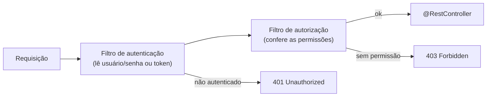

# 6.19 · Introdução ao Spring Security

> **Em uma frase:** o Spring Security protege a aplicação respondendo a duas perguntas para cada requisição: **"quem é você?"** (autenticação) e **"você pode fazer isso?"** (autorização), por meio de uma cadeia de **filtros** que roda antes dos controllers.

## 🔐 Vocabulário

| Termo | Significado | Exemplo |
| --- | --- | --- |
| **Autenticação** | Provar **quem** você é | Login com usuário e senha, token, certificado, 2FA |
| **Autorização** | Decidir **o que** você pode fazer | Só `ADMIN` pode apagar usuários |
| **Principal** | A identidade autenticada (normalmente o usuário) | `"josue"` |
| **Authority** (autoridade concedida) | Uma permissão concedida ao principal | `"ROLE_ADMIN"`, `"conta:ler"` |
| **Role** (papel / função) | Um conjunto de permissões com o prefixo `ROLE_` | `ADMIN`, `MANAGER`, `USER` |

> [!TIP]
> **Analogia do prédio:** na portaria, você mostra o documento (**autenticação**). O crachá que recebe só abre os andares liberados para você (**autorização**).

## ⛓️ Como funciona: a cadeia de filtros



Antes de a requisição chegar ao seu controller, ela passa pela **`SecurityFilterChain`**. Os filtros autenticam o usuário (guardando o resultado no `SecurityContext`) e conferem se ele tem permissão para aquela URL.

Recursos oferecidos: login por formulário, HTTP Basic, JWT/OAuth2, LDAP, SSO; proteção contra **CSRF**; cabeçalhos de segurança; codificação de senhas; regras por URL e por método (`@PreAuthorize`).

## ⚙️ Habilitando

```xml
<dependency>
    <groupId>org.springframework.boot</groupId>
    <artifactId>spring-boot-starter-security</artifactId>
</dependency>
```

Só de adicionar a dependência, **todos** os endpoints passam a exigir login. O Spring cria um usuário `user` com uma senha aleatória, impressa no console ao subir a aplicação:

```text
Using generated security password: 8e557245-73e2-4286-969a-ff57fe326336
```

> [!NOTE]
> A dependência também pode ser marcada no Spring Initializr (*Spring Security*). Cuidado com erros de digitação no `groupId`: é `org.springframework.boot`.

## 📌 Resumindo

- Autenticação = quem é você; autorização = o que você pode fazer.
- Principal, authorities e roles (`ROLE_...`) modelam identidade e permissões.
- A `SecurityFilterChain` processa cada requisição antes dos controllers.
- `401` = não autenticado; `403` = autenticado, mas sem permissão.

## 🏋️ Mão na massa

**1.** Adicione o `spring-boot-starter-security` à API da aula 6.18 e tente acessar um endpoint. O que acontece?

<details>
<summary>Ver resposta</summary>

O navegador mostra uma tela de login (ou o `curl` recebe `401`). Faça login com o usuário `user` e a senha gerada que aparece no console da aplicação.

</details>

**2.** Classifique como autenticação ou autorização: (a) validar o token JWT; (b) permitir `DELETE /contas` só para `ADMIN`; (c) pedir o código do 2FA.

<details>
<summary>Ver resposta</summary>

(a) **Autenticação**; (b) **Autorização**; (c) **Autenticação** (um segundo fator para provar a identidade).

</details>

---

<div align="center">

[⬅️ 6.18 Minha primeira API REST documentada](./18-projeto-rest-api.md) &nbsp;|&nbsp; [🏠 Índice](../../README.md) &nbsp;|&nbsp; [6.20 Autenticação simples, usuários em memória e configuração de segurança ➡️](./20-autenticacao.md)

</div>
