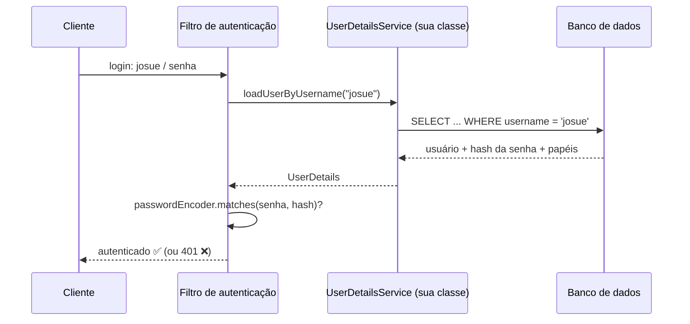

# 6.21 · Autenticação com banco de dados

> **Em uma frase:** para buscar os usuários no banco, você implementa a interface `UserDetailsService` (método `loadUserByUsername`), e o Spring Security usa o que ela devolve para conferir a senha e as permissões.

## 🗄️ A ideia



## 🛠️ Implementação

### A entidade

```java
@Entity
@Table(name = "usuarios")
public class Usuario {
    @Id
    @GeneratedValue(strategy = GenerationType.IDENTITY)
    private Long id;

    @Column(unique = true, nullable = false)
    private String username;

    @Column(nullable = false)
    private String password;          // sempre o HASH, nunca a senha pura

    @ElementCollection(fetch = FetchType.EAGER)
    private List<String> roles = new ArrayList<>();

    // getters e setters
}

public interface UsuarioRepository extends JpaRepository<Usuario, Long> {
    Optional<Usuario> findByUsername(String username);
}
```

### O `UserDetailsService`

```java
@Service
public class UsuarioDetailsService implements UserDetailsService {

    private final UsuarioRepository repository;

    public UsuarioDetailsService(UsuarioRepository repository) {
        this.repository = repository;
    }

    @Override
    public UserDetails loadUserByUsername(String username) {
        Usuario usuario = repository.findByUsername(username)
                .orElseThrow(() -> new UsernameNotFoundException("Usuário não encontrado"));

        return User.withUsername(usuario.getUsername())
                .password(usuario.getPassword())
                .roles(usuario.getRoles().toArray(String[]::new))
                .build();
    }
}
```

Com esse bean e um `PasswordEncoder` declarados (aula [6.20](./20-autenticacao.md)), o Spring Boot já usa o banco para autenticar. Não é preciso nenhuma outra configuração.

### Cadastrando um usuário inicial

```java
@Component
public class CargaInicial implements CommandLineRunner {
    private final UsuarioRepository repository;
    private final PasswordEncoder encoder;

    CargaInicial(UsuarioRepository repository, PasswordEncoder encoder) {
        this.repository = repository;
        this.encoder = encoder;
    }

    @Override
    public void run(String... args) {
        if (repository.findByUsername("admin").isEmpty()) {
            Usuario admin = new Usuario();
            admin.setUsername("admin");
            admin.setPassword(encoder.encode("master123"));
            admin.getRoles().add("MANAGER");
            repository.save(admin);
        }
    }
}
```

> [!TIP]
> Para estudar, use o banco em memória **H2** (dependência `com.h2database:h2`). Com `spring.h2.console.enabled=true`, há um console web em `/h2-console` para ver as tabelas (lembre de liberar essa URL na configuração de segurança).

> [!NOTE]
> Também existem provedores prontos: `JdbcUserDetailsManager` (com um esquema de tabelas padrão), LDAP/Active Directory e provedores externos via **OAuth2/OpenID Connect** (Google, Keycloak, Microsoft Entra ID).

📂 Projeto do curso: [`projetos/06-api-spring-security`](../../projetos/06-api-spring-security/) (Spring Boot 2.6, com `WebSecurityConfigurerAdapter`) e o exemplo `spring-web-security-database` em [`projetos/06-spring-boot-dio`](../../projetos/06-spring-boot-dio/).

## 📌 Resumindo

- Implemente `UserDetailsService.loadUserByUsername` para buscar o usuário no banco.
- Guarde só o **hash** da senha; confira com o `PasswordEncoder`.
- Papéis viram authorities com o prefixo `ROLE_`.

## 🏋️ Mão na massa

**1.** O que acontece se o `loadUserByUsername` não encontrar o usuário?

<details>
<summary>Ver resposta</summary>

Ele deve lançar `UsernameNotFoundException`. O Spring Security transforma isso numa falha de autenticação (`401`), sem revelar se o problema foi o usuário ou a senha.

</details>

**2.** Por que a mensagem de erro do login não deve dizer "usuário não existe"?

<details>
<summary>Ver resposta</summary>

Porque isso ajudaria um atacante a descobrir quais usuários existem (*user enumeration*). O ideal é uma mensagem genérica, como "usuário ou senha inválidos".

</details>

**3.** Adicione um usuário `user` com papel `USER` à carga inicial.

<details>
<summary>Ver resposta</summary>

```java
if (repository.findByUsername("user").isEmpty()) {
    Usuario user = new Usuario();
    user.setUsername("user");
    user.setPassword(encoder.encode("user123"));
    user.getRoles().add("USER");
    repository.save(user);
}
```

</details>

---

<div align="center">

[⬅️ 6.20 Autenticação simples, usuários em memória e configuração de segurança](./20-autenticacao.md) &nbsp;|&nbsp; [🏠 Índice](../../README.md) &nbsp;|&nbsp; [6.22 JWT ➡️](./22-jwt.md)

</div>
