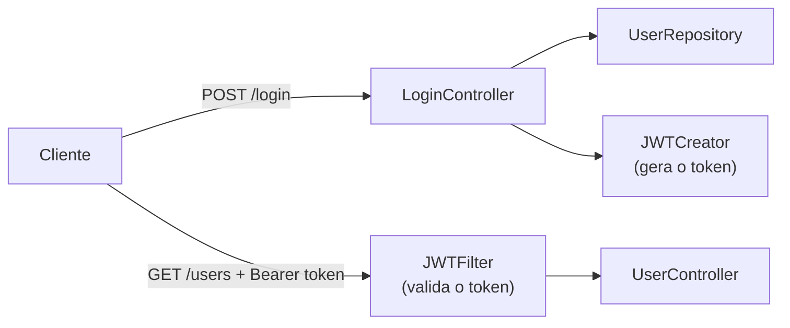

# 6.23 · Projetos: APIs com Spring Security e JWT

> **Em uma frase:** dois projetos práticos do curso: uma API com autenticação em banco de dados e papéis (`USERS`, `MANAGERS`), e uma API sem estado com login que devolve um token JWT.

## 📂 Os projetos

| Projeto | O que tem | Pasta |
| --- | --- | --- |
| **1. API com Spring Security** | Usuários no banco H2, senhas com BCrypt, papéis por endpoint, `UserDetailsService` próprio | [`projetos/06-api-spring-security`](../../projetos/06-api-spring-security/) |
| **2. API com Spring Security + JWT** | `POST /login` devolve um token; um `JWTFilter` valida o token em cada requisição; Swagger | [`projetos/06-api-spring-security-jwt`](../../projetos/06-api-spring-security-jwt/) |

### Arquitetura do projeto com JWT



| Classe | Papel |
| --- | --- |
| `LoginController` | Recebe usuário e senha, confere o hash e devolve uma `Sessao` com o token. |
| `JWTCreator` | Monta e valida os tokens (com a biblioteca JJWT). |
| `JWTFilter` | Filtro que lê o cabeçalho `Authorization`, valida o token e autentica o usuário. |
| `WebSecurityConfig` | Regras de acesso por URL e registro do filtro. |
| `SecurityConfig` | Propriedades (`security.config.prefix`, `key`, `expiration`) lidas do `application.properties`. |

## ⚠️ Versões usadas × versões atuais

Os dois projetos usam **Spring Boot 2.5/2.6**, o `WebSecurityConfigurerAdapter` e o JJWT 0.7. Para recriá-los hoje:

| No projeto | Hoje |
| --- | --- |
| `extends WebSecurityConfigurerAdapter` + `configure(HttpSecurity)` | Bean `SecurityFilterChain` (aula [6.20](./20-autenticacao.md)) |
| `.antMatchers(...)` | `.requestMatchers(...)` |
| `.authorizeRequests()` | `.authorizeHttpRequests(auth -> ...)` |
| `http.csrf().disable()` | `http.csrf(csrf -> csrf.disable())` |
| `javax.servlet.*` | `jakarta.servlet.*` |
| JJWT 0.7 (`setSubject`, `signWith(alg, key)`) | JJWT 0.12 (`subject`, `signWith(chave)`) (aula [6.22](./22-jwt.md)) |
| Springfox | springdoc-openapi |

### O filtro JWT na versão atual

```java
@Component
public class JwtFilter extends OncePerRequestFilter {

    private final JwtService jwt;
    public JwtFilter(JwtService jwt) { this.jwt = jwt; }

    @Override
    protected void doFilterInternal(HttpServletRequest req, HttpServletResponse res, FilterChain chain)
            throws ServletException, IOException {
        String header = req.getHeader("Authorization");
        if (header != null && header.startsWith("Bearer ")) {
            try {
                Claims claims = jwt.validar(header.substring(7));
                List<String> roles = claims.get("roles", List.class);
                var autoridades = roles.stream()
                        .map(r -> new SimpleGrantedAuthority("ROLE_" + r))
                        .toList();
                var autenticacao = new UsernamePasswordAuthenticationToken(claims.getSubject(), null, autoridades);
                SecurityContextHolder.getContext().setAuthentication(autenticacao);
            } catch (JwtException e) {
                res.setStatus(HttpServletResponse.SC_UNAUTHORIZED);   // token inválido ou expirado
                return;
            }
        }
        chain.doFilter(req, res);
    }
}
```

```java
@Bean
public SecurityFilterChain filterChain(HttpSecurity http, JwtFilter jwtFilter) throws Exception {
    return http
            .csrf(csrf -> csrf.disable())
            .sessionManagement(s -> s.sessionCreationPolicy(SessionCreationPolicy.STATELESS))
            .authorizeHttpRequests(auth -> auth
                    .requestMatchers(HttpMethod.POST, "/login", "/users").permitAll()
                    .requestMatchers("/swagger-ui/**", "/v3/api-docs/**").permitAll()
                    .requestMatchers(HttpMethod.GET, "/users").hasAnyRole("USERS", "MANAGERS")
                    .requestMatchers("/managers").hasRole("MANAGERS")
                    .anyRequest().authenticated())
            .addFilterBefore(jwtFilter, UsernamePasswordAuthenticationFilter.class)
            .build();
}
```

## 📌 Resumindo

- Projeto 1: autenticação com usuários no banco e papéis.
- Projeto 2: login devolve JWT; um filtro valida o token a cada requisição (sem sessão).
- Para recriar com Spring Boot 3/4: `SecurityFilterChain`, `requestMatchers`, `jakarta.*`, JJWT 0.12 e springdoc.

## 🏋️ Mão na massa

**1.** Por que a configuração com JWT usa `SessionCreationPolicy.STATELESS`?

<details>
<summary>Ver resposta</summary>

Porque a identidade do usuário vem do **token** em cada requisição. O servidor não precisa (nem deve) criar uma sessão HTTP, o que mantém a API sem estado e fácil de escalar.

</details>

**2.** Teste o fluxo completo com o `curl`: login, guardar o token e acessar um endpoint protegido.

<details>
<summary>Ver resposta</summary>

```bash
curl -X POST http://localhost:8080/login \
     -H "Content-Type: application/json" \
     -d '{"username":"admin","password":"master123"}'
# copie o valor de "token" da resposta

curl http://localhost:8080/users -H "Authorization: Bearer <token>"
```

Sem o cabeçalho, ou com um token alterado, a resposta é `401`/`403`.

</details>

---

<div align="center">

[⬅️ 6.22 JWT](./22-jwt.md) &nbsp;|&nbsp; [🏠 Índice](../../README.md) &nbsp;|&nbsp; [6.24 API REST conectada ao Amazon RDS ➡️](./24-amazon-rds.md)

</div>
