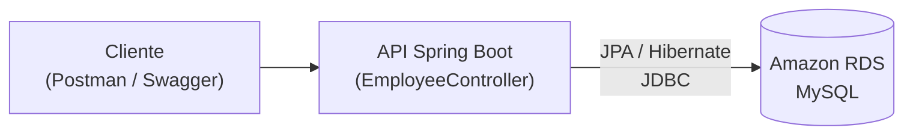

# 6.24 · API REST conectada ao Amazon RDS

> **Em uma frase:** o **Amazon RDS** é um banco relacional gerenciado pela AWS (MySQL, PostgreSQL, SQL Server...); neste projeto, uma API Spring Boot com JPA se conecta a um MySQL no RDS, e ganha uma versão com **HATEOAS**.

📄 Slides: [Criando uma API REST conectada ao Amazon RDS com Java](./slides/api-rest-amazon-rds.pdf) · Repositório original: [julianazanelatto/rdswithapirest](https://github.com/julianazanelatto/rdswithapirest) · 📂 Meu projeto: [`projetos/06-api-amazon-rds`](../../projetos/06-api-amazon-rds/)

## ☁️ O que é o RDS

O **RDS** (*Relational Database Service*) cuida da parte chata de manter um banco: instalação, atualizações, backups automáticos, réplicas e alta disponibilidade (*Multi-AZ*). Você só cria a instância, escolhe o motor (MySQL, PostgreSQL, MariaDB, Oracle, SQL Server ou **Aurora**, o banco da própria AWS) e se conecta pelo *endpoint*.



## 🛠️ O projeto

| Parte | O que faz |
| --- | --- |
| `Employee` | Entidade JPA (`@Entity`) com nome e cargo. |
| `EmployeeRepository` | `JpaRepository<Employee, Long>`: CRUD pronto. |
| `EmployeeController` | Endpoints REST: `GET/POST /employees`, `GET/PUT/DELETE /employees/{id}`. |
| `EmployeeNotFoundException` + `EmployeeNotFoundAdvice` | Exceção e `@RestControllerAdvice` que devolvem `404`. |
| `LoadDB` | `CommandLineRunner` que insere registros iniciais. |
| Pacote `Hateoas` | A mesma API com links (nível 3 de maturidade), usando o **Spring HATEOAS**, mais pedidos (`Order`) com status. |

### Conectando ao RDS

```properties
spring.datasource.url=jdbc:mysql://SEU-ENDPOINT.us-east-1.rds.amazonaws.com:3306/empresa
spring.datasource.username=${DB_USER}
spring.datasource.password=${DB_PASSWORD}
spring.jpa.hibernate.ddl-auto=update
```

> [!NOTE]
> O `ddl-auto=update` deixa o Hibernate criar e alterar as tabelas sozinho: prático para estudar, arriscado em produção. Em projetos reais, as mudanças no banco são feitas com migrações versionadas (Flyway), e o Hibernate só valida (`ddl-auto=validate`). Veja a aula [8.5](../08-extras/05-boas-praticas-api.md).

> [!CAUTION]
> Nunca escreva usuário e senha do banco direto no `application.properties` versionado. Use **variáveis de ambiente** (como acima) ou um cofre de segredos (AWS Secrets Manager).

> [!TIP]
> Para estudar sem gastar, rode o MySQL localmente com Docker (`docker run -e MYSQL_ROOT_PASSWORD=senha -e MYSQL_DATABASE=empresa -p 3306:3306 mysql:8`) e troque só a URL. O código da API é o mesmo. Se usar o RDS, apague a instância ao terminar: o nível gratuito tem limite de horas.

### HATEOAS com Spring

```java
@GetMapping("/employees/{id}")
public EntityModel<Employee> buscar(@PathVariable Long id) {
    Employee e = repository.findById(id).orElseThrow(() -> new EmployeeNotFoundException(id));
    return EntityModel.of(e,
            linkTo(methodOn(EmployeeController.class).buscar(id)).withSelfRel(),
            linkTo(methodOn(EmployeeController.class).listar()).withRel("employees"));
}
```

A resposta passa a conter `_links` com `self` e `employees`, como visto na aula [6.14](./14-rest.md).

> [!NOTE]
> O projeto usa Spring Boot 2.6 com o conector `mysql-connector-java`. Nas versões atuais, o artefato se chama `com.mysql:mysql-connector-j`.

## 📌 Resumindo

- RDS = banco relacional gerenciado pela AWS.
- A API usa Spring Data JPA e só muda a `spring.datasource.url` para apontar para o RDS.
- Credenciais em variáveis de ambiente; apague recursos da nuvem ao terminar.
- Spring HATEOAS acrescenta links às respostas.

## 🏋️ Mão na massa

**1.** Rode a API do projeto apontando para um MySQL local em Docker.

<details>
<summary>Ver resposta</summary>

```bash
docker run -d --name mysql -e MYSQL_ROOT_PASSWORD=senha -e MYSQL_DATABASE=empresa -p 3306:3306 mysql:8
```

No `application.properties`: `spring.datasource.url=jdbc:mysql://localhost:3306/empresa`, usuário `root` e senha `senha` (via variáveis de ambiente). Suba a API e acesse `GET http://localhost:8080/employees`.

</details>

**2.** Que vantagem o RDS traz em relação a instalar o MySQL numa máquina virtual (EC2) você mesmo?

<details>
<summary>Ver resposta</summary>

A AWS cuida de atualizações, backups automáticos, réplicas, failover (Multi-AZ) e monitoramento. Numa EC2, tudo isso seria responsabilidade sua.

</details>

---

<div align="center">

[⬅️ 6.23 APIs com Spring Security e JWT](./23-projetos-seguranca.md) &nbsp;|&nbsp; [🏠 Índice](../../README.md) &nbsp;|&nbsp; [6.25 Spring Data JPA na prática (Academia Digital) ➡️](./25-spring-data-jpa.md)

</div>
