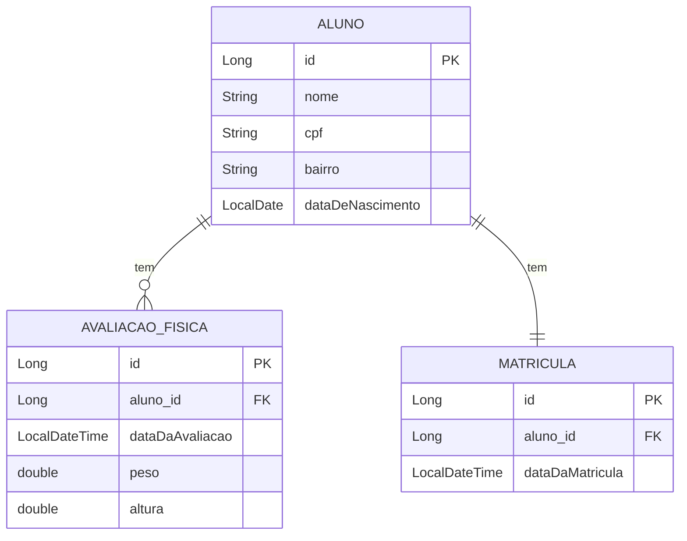
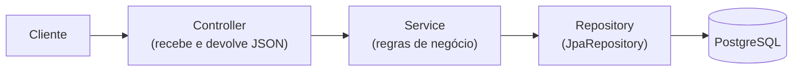

# 6.25 · Projeto: Spring Data JPA na prática (Academia Digital)

> **Em uma frase:** neste projeto, uma API de academia de ginástica com **alunos**, **avaliações físicas** e **matrículas** mostra na prática o mapeamento objeto-relacional com JPA, os relacionamentos entre entidades, validação e consultas personalizadas.

📄 Slides: [Spring Data JPA](./slides/spring-data-jpa.pdf) · Repositório original: [cami-la/academia-digital](https://github.com/cami-la/academia-digital) · 📂 Meu projeto: [`projetos/06-academia-digital`](../../projetos/06-academia-digital/) (Swagger em `http://localhost:8080/swagger-ui/index.html`)

## 🗺️ O modelo



## 🧱 Fluxo do back-end



## 🏷️ Anotações de mapeamento

| Anotação | Para quê |
| --- | --- |
| `@Entity` | A classe representa uma tabela. |
| `@Table(name = "...")` | Define o nome da tabela. |
| `@Id` | O identificador (chave primária). |
| `@GeneratedValue` | O banco gera o id (`IDENTITY`, `SEQUENCE`...). |
| `@Column` | Detalhes da coluna: nome, `unique`, `nullable`, tamanho. |
| `@OneToOne`, `@OneToMany`, `@ManyToOne`, `@ManyToMany` | Relacionamentos. |
| `@JoinColumn` | A coluna de chave estrangeira; marca o **lado dono** da relação. |
| `mappedBy` | Indica o lado **inverso** (não dono) da relação. |
| `cascade` | Propaga operações (salvar, remover) do pai para os filhos. Só faz sentido em relações pai-filho. |
| `fetch` | `LAZY` (carrega sob demanda) ou `EAGER` (carrega junto). |

```java
@Entity
@Table(name = "tb_alunos")
public class Aluno {
    @Id
    @GeneratedValue(strategy = GenerationType.IDENTITY)
    private Long id;

    private String nome;

    @Column(unique = true)
    private String cpf;

    private String bairro;
    private LocalDate dataDeNascimento;

    @OneToMany(mappedBy = "aluno", fetch = FetchType.LAZY)
    @JsonIgnore                                   // evita recursão infinita no JSON
    private List<AvaliacaoFisica> avaliacoes = new ArrayList<>();
}

@Entity
@Table(name = "tb_avaliacoes")
public class AvaliacaoFisica {
    @Id
    @GeneratedValue(strategy = GenerationType.IDENTITY)
    private Long id;

    @ManyToOne(cascade = CascadeType.ALL)
    @JoinColumn(name = "aluno_id")                // lado dono: tem a FK
    private Aluno aluno;

    private LocalDateTime dataDaAvaliacao = LocalDateTime.now();
    private double peso;
    private double altura;
}
```

> [!WARNING]
> Relacionamentos bidirecionais (aluno ↔ avaliações) causam **recursão infinita** ao converter para JSON. Use `@JsonIgnore` num dos lados ou, melhor, devolva **DTOs** em vez das entidades.

## ✅ Validação com Bean Validation

Os dados de entrada vêm em classes *Form* (DTOs), validadas com `@Valid`:

```java
public record AlunoForm(
        @NotEmpty(message = "Preencha o campo corretamente.")
        @Size(min = 3, max = 50, message = "'${validatedValue}' precisa ter entre {min} e {max} caracteres.")
        String nome,

        @NotEmpty @CPF(message = "'${validatedValue}' é inválido!")
        String cpf,

        @NotNull @Past(message = "Data '${validatedValue}' é inválida.")
        LocalDate dataDeNascimento) { }
```

## 🔍 Consultas personalizadas

```java
public interface AlunoRepository extends JpaRepository<Aluno, Long> {

    // Derived query: o Spring gera a consulta a partir do nome do método
    List<Aluno> findByDataDeNascimento(LocalDate dataDeNascimento);
}

public interface MatriculaRepository extends JpaRepository<Matricula, Long> {

    // Native query: SQL escrito à mão
    @Query(value = "SELECT * FROM tb_matriculas m INNER JOIN tb_alunos a ON m.aluno_id = a.id " +
                   "WHERE a.bairro = :bairro", nativeQuery = true)
    List<Matricula> findAlunosMatriculadosBairro(String bairro);

    // Derived query equivalente, sem SQL:
    List<Matricula> findByAlunoBairro(String bairro);
}
```

> [!NOTE]
> O projeto do curso usa Spring Boot 2.5, Java 11, `javax.validation` e Springfox. Na versão atual, troque por Java 21, `jakarta.validation` e springdoc (aulas [6.16](./16-openapi-swagger.md) e [6.10](./10-spring-framework.md)).

## 📌 Resumindo

- Entidades com `@Entity`, `@Id`, `@Column` e relacionamentos (`@OneToMany`, `@ManyToOne`, `@OneToOne`).
- `@JoinColumn` marca o lado dono; `mappedBy`, o inverso.
- Validação com Bean Validation (`@NotEmpty`, `@CPF`, `@Past`) + `@Valid`.
- Consultas: *derived queries* (pelo nome do método) ou `@Query` (JPQL ou SQL nativo).

## 🏋️ Mão na massa

**1.** Escreva uma *derived query* que busque alunos pelo nome, ignorando maiúsculas e minúsculas e aceitando parte do nome.

<details>
<summary>Ver resposta</summary>

```java
List<Aluno> findByNomeContainingIgnoreCase(String trecho);
```

</details>

**2.** Na relação `AvaliacaoFisica` → `Aluno`, qual é o lado dono e por quê?

<details>
<summary>Ver resposta</summary>

A **`AvaliacaoFisica`**, porque é a tabela dela que tem a chave estrangeira (`aluno_id`), marcada com `@JoinColumn`. O lado `Aluno` usa `mappedBy = "aluno"` e é o inverso.

</details>

**3.** Por que a API responde com um JSON gigante (ou dá `StackOverflowError`) ao buscar um aluno com avaliações, se não houver `@JsonIgnore`?

<details>
<summary>Ver resposta</summary>

Porque o aluno tem avaliações, cada avaliação tem o aluno, que tem avaliações... e o conversor de JSON entra em **recursão infinita**. Resolve-se com `@JsonIgnore` (ou `@JsonManagedReference`/`@JsonBackReference`) ou devolvendo DTOs sem o ciclo.

</details>

---

<div align="center">

[⬅️ 6.24 API REST conectada ao Amazon RDS](./24-amazon-rds.md) &nbsp;|&nbsp; [🏠 Índice](../../README.md) &nbsp;|&nbsp; [6.26 Padrões de projeto ➡️](./26-padroes-de-projeto.md)

</div>
