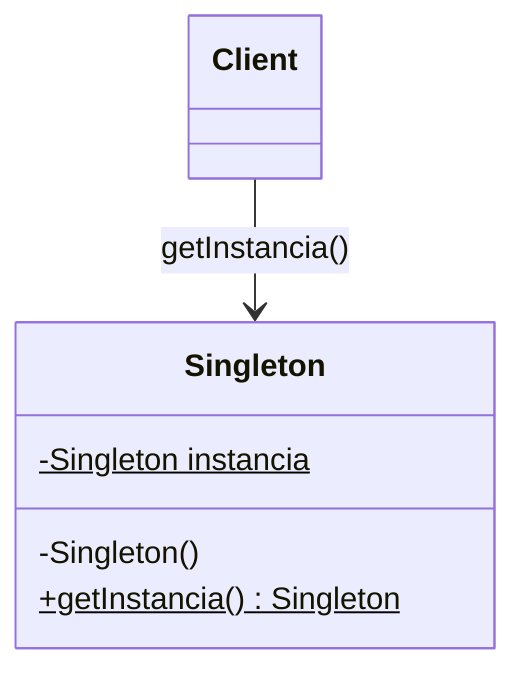
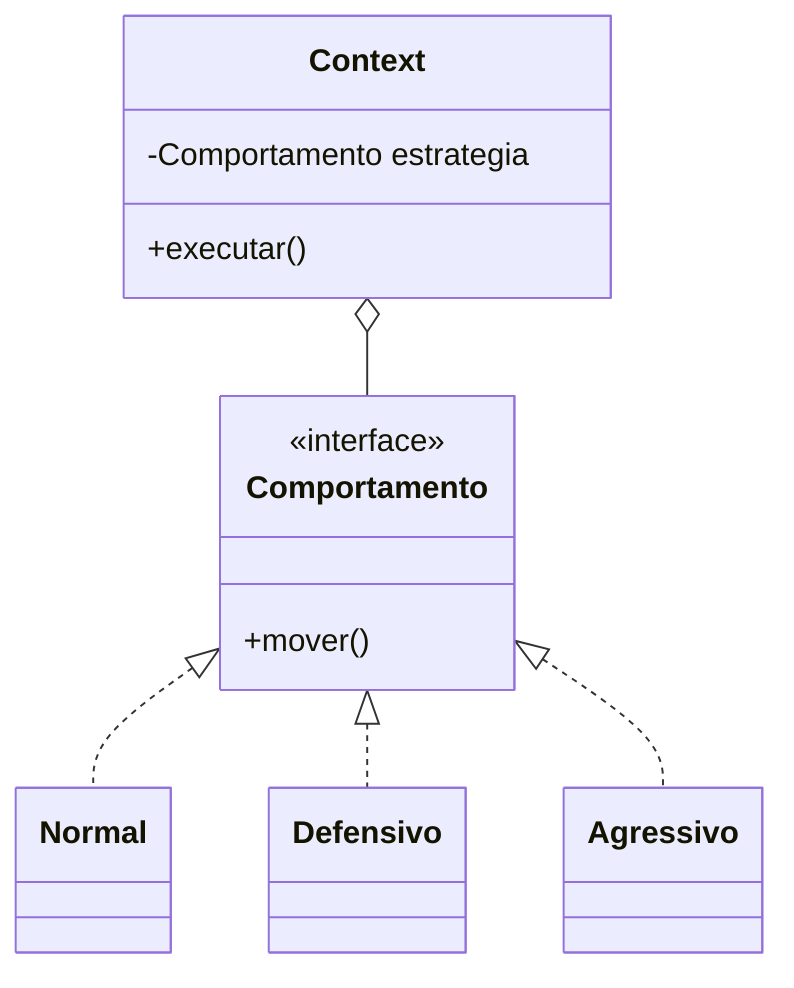
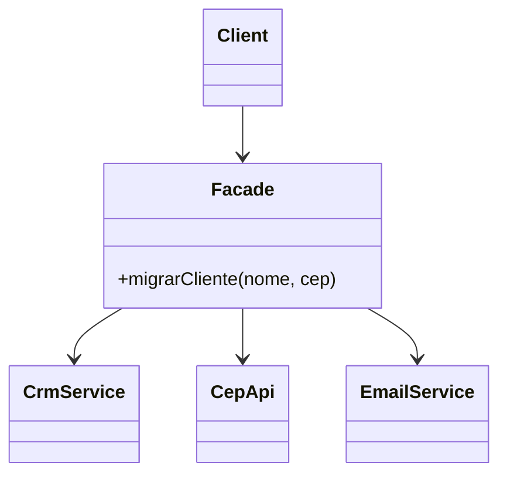

# 6.26 · Padrões de projeto: Singleton, Strategy e Facade

> **Em uma frase:** padrões de projeto (*design patterns*) são **soluções testadas** para problemas que se repetem no desenvolvimento orientado a objetos; os mais famosos são os 23 do livro da "Gangue dos Quatro" (GoF).

📄 Slides: [Explorando Padrões de Projetos na Prática com Java](./slides/padroes-de-projeto.pdf) · Repositórios do curso: [lab-padroes-projeto-java](https://github.com/digitalinnovationone/lab-padroes-projeto-java) e [lab-padroes-projeto-spring](https://github.com/digitalinnovationone/lab-padroes-projeto-spring)

> *"Alguém está sentado na sombra hoje porque alguém plantou uma árvore há muito tempo."* — Warren Buffett
>
> *"Falar é fácil. Mostre-me o código."* — Linus Torvalds

## 📚 O livro GoF

*Design Patterns: Elements of Reusable Object-Oriented Software* (1994), de **Erich Gamma, Richard Helm, Ralph Johnson e John Vlissides**, a *Gang of Four* (GoF), catalogou 23 padrões em três categorias:

| Categoria | Resolve... | Padrões |
| --- | --- | --- |
| **Criacionais** | Como **criar** objetos | Abstract Factory, Builder, Factory Method, Prototype, **Singleton** |
| **Estruturais** | Como **compor** classes e objetos | Adapter, Bridge, Composite, Decorator, **Facade**, Flyweight, Proxy |
| **Comportamentais** | Como objetos **interagem e dividem responsabilidades** | Chain of Responsibility, Command, Interpreter, Iterator, Mediator, Memento, Observer, State, **Strategy**, Template Method, Visitor |

## 1️⃣ Singleton (criacional)

**Objetivo:** garantir que uma classe tenha **uma única instância** e oferecer um ponto global de acesso a ela.



```java
public class Configuracoes {
    private static final Configuracoes INSTANCIA = new Configuracoes();   // criada uma vez

    private Configuracoes() { }                  // ninguém dá new de fora

    public static Configuracoes getInstancia() {
        return INSTANCIA;
    }
}
```

O curso mostra variações: *lazy* (criada só no primeiro uso), *eager* (criada logo, como acima) e *lazy holder* (usa uma classe interna estática; segura com várias threads).

> [!TIP]
> No Spring você quase nunca escreve um Singleton à mão: todo bean é `singleton` por padrão (aula [6.11](./11-ioc-di-e-beans.md)).

## 2️⃣ Strategy (comportamental)

**Objetivo:** definir uma **família de algoritmos** intercambiáveis, que podem ser trocados em tempo de execução sem mudar quem os usa.



```java
public interface CalculoFrete { BigDecimal calcular(Pedido p); }

public class FreteSedex implements CalculoFrete { ... }
public class FretePac implements CalculoFrete { ... }

public class Checkout {
    private CalculoFrete frete;
    public void setFrete(CalculoFrete frete) { this.frete = frete; }   // troca a estratégia
    public BigDecimal total(Pedido p) { return p.subtotal().add(frete.calcular(p)); }
}
```

## 3️⃣ Facade (estrutural)

**Objetivo:** oferecer uma **interface simples** para um conjunto complexo de subsistemas.



```java
public class CadastroFacade {
    public void migrarCliente(String nome, String cep) {
        String cidade = CepApi.getInstancia().recuperarCidade(cep);
        String estado = CepApi.getInstancia().recuperarEstado(cep);
        CrmService.gravarCliente(nome, cep, cidade, estado);
    }
}
```

Quem usa a fachada faz **uma chamada** e não precisa conhecer a API de CEP nem o CRM.

## 📌 Resumindo

- Padrões de projeto = soluções consolidadas para problemas recorrentes de OO.
- GoF: 23 padrões em criacionais, estruturais e comportamentais.
- **Singleton**: uma instância; **Strategy**: algoritmos intercambiáveis; **Facade**: interface simples para um sistema complexo.

## 🏋️ Mão na massa

**1.** Implemente o Strategy para calcular descontos: sem desconto, 10% e "Black Friday" (30%).

<details>
<summary>Ver resposta</summary>

```java
public interface Desconto {
    BigDecimal aplicar(BigDecimal valor);
}

public class SemDesconto implements Desconto {
    public BigDecimal aplicar(BigDecimal v) { return v; }
}
public class DezPorCento implements Desconto {
    public BigDecimal aplicar(BigDecimal v) { return v.multiply(new BigDecimal("0.90")); }
}
public class BlackFriday implements Desconto {
    public BigDecimal aplicar(BigDecimal v) { return v.multiply(new BigDecimal("0.70")); }
}

Desconto desconto = new BlackFriday();
System.out.println(desconto.aplicar(new BigDecimal("100")));   // 70.00
```

Como `Desconto` só tem um método, também dá para usar lambdas: `Desconto d = v -> v.multiply(new BigDecimal("0.95"));`.

</details>

**2.** Classifique: (a) `Builder`; (b) `Adapter`; (c) `Observer`.

<details>
<summary>Ver resposta</summary>

(a) **Criacional**; (b) **Estrutural**; (c) **Comportamental**.

</details>

**3.** Qual o risco de um Singleton com estado mutável num sistema com várias threads?

<details>
<summary>Ver resposta</summary>

Várias threads podem alterar o mesmo estado ao mesmo tempo, causando condições de corrida e dados inconsistentes. Singletons devem preferir ser **sem estado** (ou imutáveis) ou proteger o acesso com sincronização.

</details>

---

<div align="center">

[⬅️ 6.25 Spring Data JPA na prática (Academia Digital)](./25-spring-data-jpa.md) &nbsp;|&nbsp; [🏠 Índice](../../README.md) &nbsp;|&nbsp; [6.27 Padrões de projeto com Spring (ViaCEP + Feign) ➡️](./27-padroes-com-spring.md)

</div>
