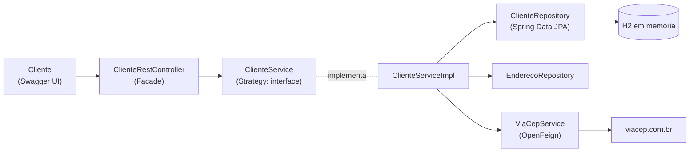

# 6.27 · Projeto: padrões de projeto com Spring (ViaCEP + Feign)

> **Em uma frase:** uma API de clientes que aplica os três padrões da aula anterior com recursos do Spring: **Singleton** com beans, **Strategy** com interfaces e implementações injetadas, e **Facade** escondendo a integração com o banco de dados e com a API de CEP (ViaCEP).

📂 Meu projeto: [`projetos/06-padroes-de-projeto`](../../projetos/06-padroes-de-projeto/) (com as versões em Java puro e com Spring)

## 🧩 Os padrões no Spring

| Padrão | Como aparece no projeto |
| --- | --- |
| **Singleton** | Os beans (`@Service`, `@Repository`) são singletons; o Spring cria e injeta uma única instância. |
| **Strategy** | A interface `ClienteService` com a implementação `ClienteServiceImpl`; trocar a implementação não afeta o controller. |
| **Facade** | O `ClienteRestController` oferece uma API simples que esconde o Spring Data JPA (banco H2 em memória) e a consulta ao **ViaCEP** via **OpenFeign**. |



## 🌐 Integração com o ViaCEP usando OpenFeign

O [ViaCEP](https://viacep.com.br/) é uma API gratuita que devolve o endereço a partir do CEP (`https://viacep.com.br/ws/01001000/json/`). Com o **Spring Cloud OpenFeign**, basta declarar uma interface:

```java
@FeignClient(name = "viacep", url = "https://viacep.com.br/ws")
public interface ViaCepService {

    @GetMapping("/{cep}/json/")
    Endereco consultarCep(@PathVariable("cep") String cep);
}
```

```java
@SpringBootApplication
@EnableFeignClients                 // ativa os clientes Feign
public class Application { ... }
```

O Feign gera a implementação: chamar `viaCepService.consultarCep("01001000")` faz a requisição HTTP e converte o JSON em `Endereco`.

> [!TIP]
> Para criar a classe `Endereco` a partir do JSON de exemplo, o curso usou o [jsonschema2pojo](https://www.jsonschema2pojo.org/). Hoje, um `record` com os campos do JSON resolve em poucas linhas. A partir do Spring Framework 6, também existe a alternativa nativa **HTTP Interface** (`@HttpExchange`) com o `RestClient`, sem depender do Spring Cloud.

### O serviço

```java
@Service
public class ClienteServiceImpl implements ClienteService {

    private final ClienteRepository clientes;
    private final EnderecoRepository enderecos;
    private final ViaCepService viaCep;

    public ClienteServiceImpl(ClienteRepository clientes, EnderecoRepository enderecos, ViaCepService viaCep) {
        this.clientes = clientes;
        this.enderecos = enderecos;
        this.viaCep = viaCep;
    }

    @Override
    public void inserir(Cliente cliente) {
        String cep = cliente.getEndereco().getCep();
        Endereco endereco = enderecos.findById(cep).orElseGet(() -> {
            Endereco novo = viaCep.consultarCep(cep);    // só consulta o ViaCEP se ainda não tiver
            return enderecos.save(novo);
        });
        cliente.setEndereco(endereco);
        clientes.save(cliente);
    }
    // buscarTodos, buscarPorId, atualizar, deletar...
}
```

## ✍️ O que acrescentei ao projeto

- Atualização de dependências e versões no `pom.xml` (Java 17, Hibernate e Spring Data com versões fixas).
- `buscarPorId` com tratamento quando o cliente não existe.
- `deletar` lançando a exceção `ClienteNEncException` ("Cliente não encontrado com o ID") quando o id não existe.
- Swagger acessível em `http://localhost:8080/swagger-ui.html`.

## 📌 Resumindo

- Singleton → beans; Strategy → interface + implementação injetada; Facade → controller simples sobre integrações complexas.
- OpenFeign transforma uma interface anotada num cliente HTTP.
- Cache simples: o endereço só é buscado no ViaCEP se ainda não estiver no banco.

## 🏋️ Mão na massa

**1.** Consulte o ViaCEP pelo terminal com o CEP da sua cidade.

<details>
<summary>Ver resposta</summary>

```bash
curl https://viacep.com.br/ws/01001000/json/
```

A resposta é um JSON com `logradouro`, `bairro`, `localidade` (cidade), `uf` etc.

</details>

**2.** Crie um `record Endereco` para receber a resposta do ViaCEP.

<details>
<summary>Ver resposta</summary>

```java
public record Endereco(String cep, String logradouro, String complemento,
                       String bairro, String localidade, String uf) { }
```

Campos do JSON que não estiverem no `record` são ignorados (comportamento padrão do Spring Boot).

</details>

**3.** Onde está o padrão Strategy, se só existe uma implementação de `ClienteService`?

<details>
<summary>Ver resposta</summary>

Na **estrutura**: o controller depende da interface, não da implementação. Se amanhã surgir uma `ClienteServiceComCache` ou uma versão de testes, basta trocar o bean injetado, sem alterar o controller. A estratégia pode ser trocada mesmo que hoje só exista uma.

</details>

---

<div align="center">

[⬅️ 6.26 Padrões de projeto](./26-padroes-de-projeto.md) &nbsp;|&nbsp; [🏠 Índice](../../README.md) &nbsp;|&nbsp; [7.1 Animal ➡️](../07-desafios-intermediarios/01-animal.md)

</div>
