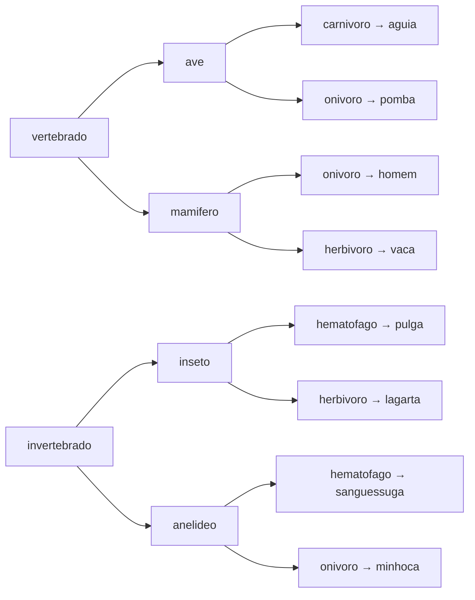

# 7.1 · Desafio: Animal

> **Em uma frase:** a partir de três palavras (classe, grupo e alimentação), descobrir qual animal foi escolhido seguindo uma árvore de decisões.

## 📋 Enunciado

Leia 3 palavras, uma por linha, todas em minúsculas, e imprima o animal correspondente segundo o esquema:



| Entrada | Saída |
| --- | --- |
| `vertebrado` `mamifero` `onivoro` | `homem` |
| `vertebrado` `ave` `carnivoro` | `aguia` |
| `invertebrado` `anelideo` `onivoro` | `minhoca` |

## 🧠 Como pensar

São três níveis de decisão. Dá para resolver com `if`s aninhados, mas como a resposta depende da **combinação** das três palavras, uma solução mais elegante junta as palavras numa chave e usa um `switch` (ou um `Map`).

<details>
<summary>Ver resposta</summary>

```java
import java.util.Scanner;

public class Main {
    public static void main(String[] args) {
        Scanner entrada = new Scanner(System.in);
        String classe = entrada.nextLine().trim();
        String grupo = entrada.nextLine().trim();
        String alimentacao = entrada.nextLine().trim();

        String animal = switch (classe + "/" + grupo + "/" + alimentacao) {
            case "vertebrado/ave/carnivoro"        -> "aguia";
            case "vertebrado/ave/onivoro"          -> "pomba";
            case "vertebrado/mamifero/onivoro"     -> "homem";
            case "vertebrado/mamifero/herbivoro"   -> "vaca";
            case "invertebrado/inseto/hematofago"  -> "pulga";
            case "invertebrado/inseto/herbivoro"   -> "lagarta";
            case "invertebrado/anelideo/hematofago"-> "sanguessuga";
            case "invertebrado/anelideo/onivoro"   -> "minhoca";
            default -> "desconhecido";
        };
        System.out.println(animal);
    }
}
```

A solução do curso, com `if`s aninhados, também funciona:

```java
if (a1.equals("vertebrado") && a2.equals("ave")) {
    if (a3.equals("carnivoro")) System.out.println("aguia");
    else if (a3.equals("onivoro")) System.out.println("pomba");
} else if (a1.equals("vertebrado") && a2.equals("mamifero")) {
    // ...
}
```

</details>

## 🏋️ Mão na massa

**1.** Por que comparar as Strings com `.equals()` e não com `==`?

<details>
<summary>Ver resposta</summary>

Porque `==` compara se são o **mesmo objeto** na memória. Textos lidos do teclado são objetos novos, então `==` daria `false` mesmo com o mesmo conteúdo. `.equals()` compara o conteúdo.

</details>

**2.** Reescreva a solução usando um `Map<String, String>`.

<details>
<summary>Ver resposta</summary>

```java
Map<String, String> animais = Map.of(
        "vertebrado/ave/carnivoro", "aguia",
        "vertebrado/ave/onivoro", "pomba",
        "vertebrado/mamifero/onivoro", "homem",
        "vertebrado/mamifero/herbivoro", "vaca",
        "invertebrado/inseto/hematofago", "pulga",
        "invertebrado/inseto/herbivoro", "lagarta",
        "invertebrado/anelideo/hematofago", "sanguessuga",
        "invertebrado/anelideo/onivoro", "minhoca");

System.out.println(animais.getOrDefault(classe + "/" + grupo + "/" + alimentacao, "desconhecido"));
```

Com o mapa, acrescentar um animal novo é só uma linha a mais.

</details>

---

<div align="center">

[⬅️ 6.27 Padrões de projeto com Spring (ViaCEP + Feign)](../06-spring/27-padroes-com-spring.md) &nbsp;|&nbsp; [🏠 Índice](../../README.md) &nbsp;|&nbsp; [7.2 Quitanda do Seu Zé ➡️](./02-quitanda.md)

</div>
