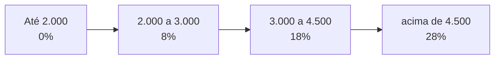

# 7.5 · Desafio: Taxa de Imposto de Renda

> **Em uma frase:** calcular o imposto de renda **por faixas progressivas**: cada alíquota incide só sobre a parte do salário que está dentro da sua faixa.

## 📋 Enunciado

No país de Lolipad, o imposto segue esta tabela:

| Renda | Alíquota |
| --- | --- |
| Até R$ 2.000,00 | Isento |
| De R$ 2.000,01 a R$ 3.000,00 | 8% |
| De R$ 3.000,01 a R$ 4.500,00 | 18% |
| Acima de R$ 4.500,00 | 28% |

Leia o salário (com duas casas decimais) e imprima `R$` seguido do imposto com duas casas, ou `Isento` se não houver imposto.

| Entrada | Saída |
| --- | --- |
| `3002.00` | `R$ 80.36` |
| `1701.12` | `Isento` |
| `4520.00` | `R$ 355.60` |

## 🧠 Como pensar

O ponto-chave é que a alíquota **não** se aplica ao salário inteiro: cada "fatia" paga a sua.



Para R$ 4.520,00:

| Fatia | Valor na fatia | Alíquota | Imposto |
| --- | --- | --- | --- |
| 0 a 2.000 | 2.000,00 | 0% | 0,00 |
| 2.000 a 3.000 | 1.000,00 | 8% | 80,00 |
| 3.000 a 4.500 | 1.500,00 | 18% | 270,00 |
| acima de 4.500 | 20,00 | 28% | 5,60 |
| **Total** | | | **355,60** |

<details>
<summary>Ver resposta</summary>

```java
import java.util.Locale;
import java.util.Scanner;

public class Main {
    public static void main(String[] args) {
        Scanner entrada = new Scanner(System.in).useLocale(Locale.US);
        double renda = entrada.nextDouble();
        double imposto;

        if (renda <= 2000.0) {
            imposto = 0.0;
        } else if (renda <= 3000.0) {
            imposto = (renda - 2000.0) * 0.08;
        } else if (renda <= 4500.0) {
            imposto = 1000.0 * 0.08 + (renda - 3000.0) * 0.18;
        } else {
            imposto = 1000.0 * 0.08 + 1500.0 * 0.18 + (renda - 4500.0) * 0.28;
        }

        if (imposto == 0.0) {
            System.out.println("Isento");
        } else {
            System.out.println(String.format(Locale.US, "R$ %.2f", imposto));
        }
    }
}
```

O `Locale.US` garante o formato `80.36` (com ponto). Sem ele, num computador em português, sairia `R$ 80,36`, e a saída seria considerada errada pela plataforma.

</details>

> [!NOTE]
> O Imposto de Renda brasileiro funciona de forma parecida (por faixas), mas costuma ser calculado com a fórmula equivalente "salário × alíquota da faixa − parcela a deduzir". As duas formas dão o mesmo resultado.

## 🏋️ Mão na massa

**1.** Calcule à mão o imposto de quem ganha R$ 3.500,00.

<details>
<summary>Ver resposta</summary>

1.000 × 8% = 80,00 e 500 × 18% = 90,00 → **R$ 170,00**.

</details>

**2.** Generalize a solução usando arrays com os limites e as alíquotas, para que mudar a tabela não exija mexer nos `if`s.

<details>
<summary>Ver resposta</summary>

```java
double[] limites   = {2000.0, 3000.0, 4500.0, Double.MAX_VALUE};
double[] aliquotas = {0.0,    0.08,   0.18,   0.28};

double imposto = 0, inicioDaFaixa = 0;
for (int i = 0; i < limites.length && renda > inicioDaFaixa; i++) {
    double valorNaFaixa = Math.min(renda, limites[i]) - inicioDaFaixa;
    imposto += valorNaFaixa * aliquotas[i];
    inicioDaFaixa = limites[i];
}
```

</details>

---

<div align="center">

[⬅️ 7.4 Contar espaços e vogais](./04-espacos-e-vogais.md) &nbsp;|&nbsp; [🏠 Índice](../../README.md) &nbsp;|&nbsp; [8.1 Java moderno ➡️](../08-extras/01-java-moderno.md)

</div>
