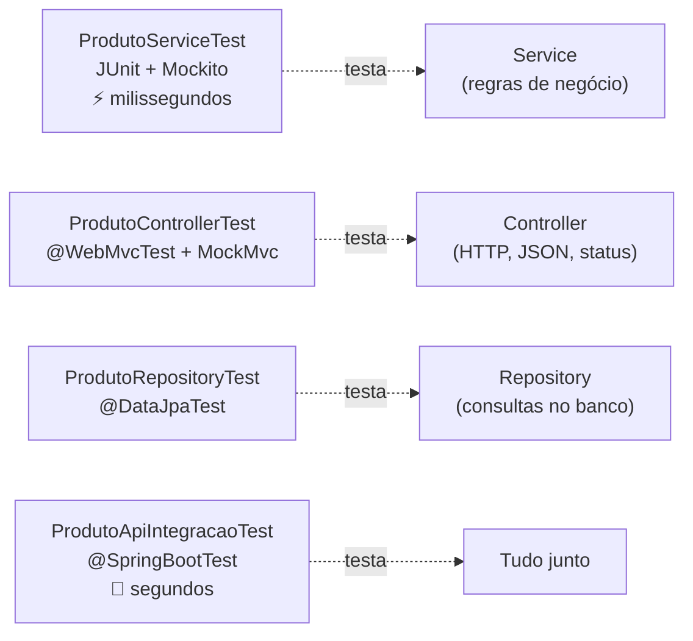

# 8.4 · Testando uma API Spring Boot

> **Em uma frase:** numa API Spring, cada camada tem seu tipo de teste: o **service** é testado sozinho com **Mockito** (dublês no lugar das dependências), o **controller** com `@WebMvcTest` + **MockMvc**, o **repository** com `@DataJpaTest` e a aplicação inteira com `@SpringBootTest`.

> [!NOTE]
> Conteúdo extra: esta aula não faz parte do curso original. Ela continua as aulas de testes ([4.21](../04-poo/21-testes-unitarios.md) a [4.23](../04-poo/23-testes-boas-praticas.md)) e usa a API de produtos da aula [8.5](./05-boas-praticas-api.md). Todo o código foi testado com Spring Boot 4.1 e Java 21.

## 🧱 Qual teste para qual camada?



| Tipo | Anotação | Sobe o Spring? | Banco? | Use para testar |
| --- | --- | --- | --- | --- |
| **Unitário** | `@ExtendWith(MockitoExtension.class)` | Não | Não | Regras de negócio do service |
| **Fatia web** | `@WebMvcTest` | Só a camada web | Não | Rotas, JSON, validação, códigos de status |
| **Fatia de dados** | `@DataJpaTest` | Só o JPA | Sim (H2 em memória) | Consultas do repository |
| **Integração** | `@SpringBootTest` | Tudo | Sim | O fluxo completo, de ponta a ponta |

Seguindo a pirâmide de testes da aula [4.21](../04-poo/21-testes-unitarios.md): **muitos** testes unitários (rápidos) e **poucos** de integração (lentos).

## 📦 Dependências

O Spring Initializr já adiciona as dependências de teste. No Spring Boot 4, há um starter de teste para cada módulo:

```xml
<dependency>
    <groupId>org.springframework.boot</groupId>
    <artifactId>spring-boot-starter-webmvc-test</artifactId>
    <scope>test</scope>
</dependency>
<dependency>
    <groupId>org.springframework.boot</groupId>
    <artifactId>spring-boot-starter-data-jpa-test</artifactId>
    <scope>test</scope>
</dependency>
<dependency>
    <groupId>com.h2database</groupId>
    <artifactId>h2</artifactId>
    <scope>runtime</scope>
</dependency>
```

Eles trazem JUnit, Mockito, AssertJ e as ferramentas de teste do Spring.

> [!NOTE]
> No **Spring Boot 3**, um único `spring-boot-starter-test` traz tudo, e as anotações ficam em pacotes um pouco diferentes (por exemplo, `org.springframework.boot.test.autoconfigure.web.servlet.WebMvcTest`). A forma de escrever os testes é a mesma.

## 🎭 1. Testando o service com Mockito

O `ProdutoService` depende do `ProdutoRepository`, que depende do banco. Para testar **só** a regra do service, trocamos o repository por um **dublê** (*mock*): um objeto falso que devolve o que mandarmos.

```java
@ExtendWith(MockitoExtension.class)
class ProdutoServiceTest {

    @Mock
    ProdutoRepository repository;            // dublê: não acessa banco nenhum

    @InjectMocks
    ProdutoService service;                  // a classe testada, já recebendo o dublê

    @Test
    void deveBuscarProdutoExistente() {
        Produto teclado = new Produto("Teclado", new BigDecimal("149.90"), 30);
        when(repository.findById(1L)).thenReturn(Optional.of(teclado));   // "ensaia" o dublê

        ProdutoResponse resposta = service.buscar(1L);

        assertEquals("Teclado", resposta.nome());
        assertTrue(resposta.disponivel());
        verify(repository).findById(1L);                                   // foi chamado?
    }

    @Test
    void deveLancarExcecaoQuandoProdutoNaoExiste() {
        when(repository.findById(99L)).thenReturn(Optional.empty());

        assertThrows(ProdutoNaoEncontradoException.class, () -> service.buscar(99L));
    }
}
```

| Mockito | Faz |
| --- | --- |
| `@Mock` | Cria o dublê |
| `@InjectMocks` | Cria a classe testada e injeta os dublês no construtor |
| `when(...).thenReturn(...)` | "Quando chamarem isso, devolva aquilo" |
| `when(...).thenThrow(...)` | "Quando chamarem isso, lance esta exceção" |
| `verify(mock).metodo(...)` | Confere se o método foi chamado |
| `verify(mock, never()).save(any())` | Confere que **não** foi chamado |

> [!TIP]
> Aqui aparece mais uma vantagem da injeção por **construtor** (aula [6.11](../06-spring/11-ioc-di-e-beans.md)): como o service recebe o repository de fora, é trivial entregar um dublê no lugar do verdadeiro. Esses testes nem sobem o Spring e rodam em milissegundos.

## 🌐 2. Testando o controller com `@WebMvcTest` e MockMvc

O `@WebMvcTest` sobe **só** a camada web (controllers, validação, `@RestControllerAdvice`, conversão de JSON). O **MockMvc** simula requisições HTTP sem abrir porta nenhuma, e o `@MockitoBean` coloca um dublê do service dentro do Spring.

```java
@WebMvcTest(ProdutoController.class)
class ProdutoControllerTest {

    @Autowired
    MockMvc mockMvc;                         // simula requisições HTTP, sem subir servidor

    @MockitoBean
    ProdutoService service;                  // o service vira um dublê dentro do Spring

    @Test
    void deveDevolverProdutoComStatus200() throws Exception {
        when(service.buscar(1L))
                .thenReturn(new ProdutoResponse(1L, "Teclado", new BigDecimal("149.90"), true));

        mockMvc.perform(get("/produtos/1"))
                .andExpect(status().isOk())
                .andExpect(jsonPath("$.nome").value("Teclado"))
                .andExpect(jsonPath("$.disponivel").value(true));
    }

    @Test
    void deveDevolver404QuandoNaoExiste() throws Exception {
        when(service.buscar(99L)).thenThrow(new ProdutoNaoEncontradoException(99L));

        mockMvc.perform(get("/produtos/99"))
                .andExpect(status().isNotFound())
                .andExpect(jsonPath("$.detail").value("Produto 99 não encontrado"));
    }

    @Test
    void deveRecusarProdutoSemNome() throws Exception {
        String json = """
                { "nome": "", "preco": 10.00, "estoque": 1 }
                """;

        mockMvc.perform(post("/produtos").contentType(MediaType.APPLICATION_JSON).content(json))
                .andExpect(status().isBadRequest());
    }
}
```

- `perform(get(...))` faz a requisição; `andExpect(...)` confere a resposta.
- `jsonPath("$.nome")` navega no JSON devolvido: `$` é a raiz, `$.content[0].nome` seria o nome do primeiro item de uma lista.
- O terceiro teste prova que o `@Valid` está funcionando: nome vazio → `400`.

> [!NOTE]
> O `@MockitoBean` substituiu o antigo `@MockBean`, que foi descontinuado no Spring Boot 3.4 e removido no 4. Em tutoriais antigos você ainda verá o `@MockBean`.

## 🗄️ 3. Testando o repository com `@DataJpaTest`

O `@DataJpaTest` sobe só o JPA, com um banco **H2 em memória**, e desfaz (rollback) tudo ao fim de cada teste. Ideal para conferir se as consultas fazem o que você espera:

```java
@DataJpaTest
class ProdutoRepositoryTest {

    @Autowired
    ProdutoRepository repository;

    @Test
    void deveBuscarPorParteDoNomeSemDiferenciarMaiusculas() {
        repository.save(new Produto("Cadeira gamer", new BigDecimal("1299.00"), 5));

        Page<Produto> pagina = repository.findByNomeContainingIgnoreCase("GAMER", PageRequest.of(0, 10));

        assertEquals(1, pagina.getTotalElements());
        assertEquals("Cadeira gamer", pagina.getContent().get(0).getNome());
    }
}
```

> [!TIP]
> Não vale a pena testar métodos prontos como `save` ou `findById`: o Spring Data já é testado. Teste as **suas** consultas: métodos derivados complexos e as com `@Query`.

## 🔗 4. Testando tudo junto com `@SpringBootTest`

O `@SpringBootTest` sobe a aplicação **inteira** (com o banco H2 e as migrações do Flyway). Com o `@AutoConfigureMockMvc`, as requisições passam por todas as camadas de verdade:

```java
@SpringBootTest
@AutoConfigureMockMvc
class ProdutoApiIntegracaoTest {

    @Autowired
    MockMvc mockMvc;

    @Test
    void deveCriarEDepoisListarProduto() throws Exception {
        mockMvc.perform(post("/produtos")
                        .contentType(MediaType.APPLICATION_JSON)
                        .content("""
                                { "nome": "Webcam", "preco": 199.90, "estoque": 0 }
                                """))
                .andExpect(status().isCreated())
                .andExpect(header().exists("Location"))
                .andExpect(jsonPath("$.disponivel").value(false));

        mockMvc.perform(get("/produtos").param("nome", "web"))
                .andExpect(status().isOk())
                .andExpect(jsonPath("$.content[0].nome").value("Webcam"));
    }
}
```

> [!NOTE]
> Para testar com o **mesmo** banco da produção (PostgreSQL em vez de H2), use o **Testcontainers**: ele sobe um contêiner Docker do banco durante os testes. É o padrão em projetos profissionais.

Rode tudo com `./mvnw test`:

```text
[INFO] Tests run: 2, Failures: 0, Errors: 0, Skipped: 0 -- in com.loja.api.produto.ProdutoApiIntegracaoTest
[INFO] Tests run: 3, Failures: 0, Errors: 0, Skipped: 0 -- in com.loja.api.produto.ProdutoControllerTest
[INFO] Tests run: 1, Failures: 0, Errors: 0, Skipped: 0 -- in com.loja.api.produto.ProdutoRepositoryTest
[INFO] Tests run: 2, Failures: 0, Errors: 0, Skipped: 0 -- in com.loja.api.produto.ProdutoServiceTest
[INFO] BUILD SUCCESS
```

## 📌 Resumindo

- Service: teste unitário com **Mockito** (`@Mock`, `@InjectMocks`, `when`, `verify`), sem Spring.
- Controller: `@WebMvcTest` + **MockMvc** + `@MockitoBean`; confira status, JSON (`jsonPath`) e validação.
- Repository: `@DataJpaTest`, com H2 em memória e rollback automático; teste as suas consultas.
- Aplicação inteira: `@SpringBootTest` + `@AutoConfigureMockMvc`; poucos, porque são lentos.
- Testcontainers permite testar com o banco real em Docker.

## 🏋️ Mão na massa

**1.** Escreva um teste unitário garantindo que `criar` chama o `save` do repository.

<details>
<summary>Ver resposta</summary>

```java
@Test
void deveSalvarAoCriar() {
    var request = new NovoProdutoRequest("Mouse", new BigDecimal("59.90"), 10);
    when(repository.save(any(Produto.class))).thenAnswer(chamada -> chamada.getArgument(0));

    ProdutoResponse resposta = service.criar(request);

    assertEquals("Mouse", resposta.nome());
    verify(repository).save(any(Produto.class));
}
```

O `thenAnswer` devolve o próprio produto recebido, imitando o `save` de verdade.

</details>

**2.** Qual tipo de teste você usaria para verificar que `GET /produtos/abc` (id que não é número) devolve `400`?

<details>
<summary>Ver resposta</summary>

Um `@WebMvcTest`: é um comportamento da camada web (conversão do `@PathVariable`), e não precisa de banco nem de regra de negócio.

```java
mockMvc.perform(get("/produtos/abc")).andExpect(status().isBadRequest());
```

</details>

**3.** Por que não usar só `@SpringBootTest` em todos os testes, já que ele testa "tudo de verdade"?

<details>
<summary>Ver resposta</summary>

Porque ele sobe a aplicação inteira e fica **lento**; com centenas de testes, a suíte levaria minutos. Além disso, quando um teste de integração falha, é mais difícil saber **qual** camada quebrou. Testes unitários e de fatia são rápidos e apontam o problema com precisão.

</details>

---

<div align="center">

[⬅️ 8.3 Docker para quem programa em Java](./03-docker-para-java.md) &nbsp;|&nbsp; [🏠 Índice](../../README.md) &nbsp;|&nbsp; [8.5 Boas práticas em APIs ➡️](./05-boas-praticas-api.md)

</div>
