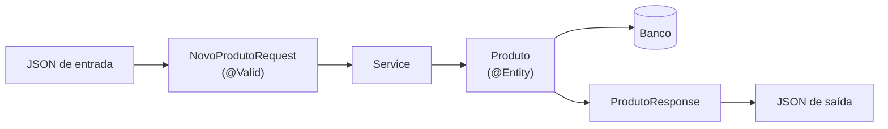

# 8.5 · Boas práticas em APIs: DTOs, paginação, migrações e logs

> **Em uma frase:** quatro hábitos separam uma API de estudo de uma API profissional: expor **DTOs** em vez das entidades, **paginar** listas, versionar o banco com **migrações** (Flyway) e registrar o que acontece com **logs** bem feitos.

> [!NOTE]
> Conteúdo extra: esta aula não faz parte do curso original. Ela parte do que você viu no módulo 6 (Spring Boot, REST e Spring Data JPA) e foi testada com Spring Boot 4.1 e Java 21. Os testes desta API estão na aula [8.4](./04-testes-spring-boot.md).

## 📦 1. DTOs: não exponha suas entidades

É tentador devolver a entidade JPA direto no controller. Funciona, mas cria problemas:

| Problema | Exemplo |
| --- | --- |
| Vaza dados que não deveriam sair | A entidade `Usuario` tem o hash da senha |
| O cliente pode alterar campos indevidos | Um `POST` com `"id": 1` ou `"saldo": 1000000` |
| Qualquer mudança no banco quebra quem usa a API | Renomear uma coluna muda o JSON |
| Laços infinitos e erros de *lazy loading* | Relacionamentos bidirecionais (aula [8.6](./06-erros-comuns.md)) |

A solução é usar **DTOs** (*Data Transfer Objects*): classes só para os dados que **entram** e **saem** da API. Os `record`s (aula [8.1](./01-java-moderno.md)) são perfeitos para isso:

```java
// O que ENTRA no POST: só o que o cliente pode informar, com validação
public record NovoProdutoRequest(
        @NotBlank String nome,
        @NotNull @Positive BigDecimal preco,
        @PositiveOrZero int estoque) {

    public Produto paraEntidade() {
        return new Produto(nome, preco, estoque);
    }
}

// O que SAI: só o que interessa a quem consome a API
public record ProdutoResponse(Long id, String nome, BigDecimal preco, boolean disponivel) {

    public static ProdutoResponse de(Produto produto) {
        return new ProdutoResponse(produto.getId(), produto.getNome(),
                produto.getPreco(), produto.getEstoque() > 0);
    }
}
```

Repare que a resposta não mostra o estoque exato, só se o produto está `disponivel`: o DTO permite decidir o formato da API **independentemente** do banco.



> [!TIP]
> Para converter entre entidades e DTOs, métodos simples como `de(...)` e `paraEntidade()` bastam. Em projetos grandes, bibliotecas como o **MapStruct** geram esse código automaticamente.

## 📄 2. Paginação: nunca devolva "tudo"

Um `GET /produtos` que devolve a tabela inteira funciona com 10 produtos e derruba a API com 1 milhão. O Spring Data resolve com `Pageable`:

```java
public interface ProdutoRepository extends JpaRepository<Produto, Long> {
    Page<Produto> findByNomeContainingIgnoreCase(String nome, Pageable pageable);
}
```

```java
@GetMapping
public Page<ProdutoResponse> listar(
        @RequestParam(defaultValue = "") String nome,
        @PageableDefault(size = 20, sort = "nome") Pageable pageable) {
    return service.listar(nome, pageable);
}
```

```java
// no service: converte cada entidade da página em DTO
public Page<ProdutoResponse> listar(String nome, Pageable pageable) {
    return repository.findByNomeContainingIgnoreCase(nome, pageable).map(ProdutoResponse::de);
}
```

O cliente escolhe a página pela URL:

```text
GET /produtos?page=0&size=2&sort=preco,desc
```

| Parâmetro | Significa | Padrão (com o `@PageableDefault` acima) |
| --- | --- | --- |
| `page` | Número da página, **começando em 0** | 0 |
| `size` | Itens por página | 20 |
| `sort` | Campo e direção (`campo,asc` ou `campo,desc`) | `nome` |

Por baixo, o Spring Data gera o `LIMIT`/`OFFSET` e o `ORDER BY` da aula [5.6](../05-banco-de-dados/06-sql-consultas.md), mais um `COUNT(*)` para saber o total.

Para o JSON ter um formato **estável**, ative o modo DTO de serialização na classe principal:

```java
@SpringBootApplication
@EnableSpringDataWebSupport(pageSerializationMode = VIA_DTO)
public class ApiApplication { ... }
```

A resposta fica assim:

```json
{
  "content": [
    { "id": 3, "nome": "Monitor", "preco": 899.00, "disponivel": true },
    { "id": 1, "nome": "Teclado", "preco": 149.90, "disponivel": true }
  ],
  "page": { "size": 2, "number": 0, "totalElements": 3, "totalPages": 2 }
}
```

> [!NOTE]
> Sem o `VIA_DTO`, o Spring avisa no log: *Serializing PageImpl instances as-is is not supported, meaning that there is no guarantee about the stability of the resulting JSON structure!*, e o JSON sai com vários campos internos.

## 🗂️ 3. Migrações de banco com Flyway

Até aqui, o `spring.jpa.hibernate.ddl-auto=update` criava as tabelas sozinho. Isso é prático para estudar, mas **perigoso em produção**: o Hibernate não apaga colunas antigas, não renomeia nada e ninguém sabe exatamente que mudanças foram feitas em cada ambiente.

Uma **migração** é um arquivo SQL versionado com uma mudança no banco. O **Flyway** aplica, na ordem, as migrações que ainda não rodaram naquele banco e registra cada uma numa tabela de controle (`flyway_schema_history`). É como um "Git do banco de dados".

Adicione o starter `spring-boot-starter-flyway` (e, para PostgreSQL ou MySQL, também o módulo `flyway-database-postgresql` ou `flyway-mysql`) e crie os arquivos em `src/main/resources/db/migration`:

```text
src/main/resources/db/migration/
├── V1__cria_tabela_produtos.sql
└── V2__insere_produtos_iniciais.sql
```

```sql
-- V1__cria_tabela_produtos.sql
CREATE TABLE produtos (
    id       BIGINT GENERATED BY DEFAULT AS IDENTITY PRIMARY KEY,
    nome     VARCHAR(100) NOT NULL,
    preco    DECIMAL(10, 2) NOT NULL,
    estoque  INTEGER NOT NULL DEFAULT 0
);
```

```sql
-- V2__insere_produtos_iniciais.sql
INSERT INTO produtos (nome, preco, estoque) VALUES
    ('Teclado', 149.90, 30),
    ('Mouse', 59.90, 50),
    ('Monitor', 899.00, 10);
```

```properties
# O Flyway cria as tabelas; o Hibernate só confere se as entidades batem com elas
spring.jpa.hibernate.ddl-auto=validate
```

Ao subir a aplicação, o log mostra:

```text
Migrating schema "PUBLIC" to version "1 - cria tabela produtos"
Migrating schema "PUBLIC" to version "2 - insere produtos iniciais"
```

| Regra | Por quê |
| --- | --- |
| Nome no formato `V<número>__<descricao>.sql` (dois sublinhados) | É assim que o Flyway descobre a ordem |
| **Nunca edite** uma migração que já rodou | O Flyway guarda um *checksum* e recusa subir se o arquivo mudar |
| Para mudar algo, crie uma migração **nova** (`V3__adiciona_coluna_categoria.sql`) | O histórico fica completo e igual em todos os ambientes |
| Use `ddl-auto=validate` (ou `none`) | Quem muda o banco é o Flyway, não o Hibernate |

> [!TIP]
> O **Liquibase** é uma alternativa ao Flyway, com a mesma ideia (e suporte a XML/YAML além de SQL). Escolha um e use-o desde o início do projeto.

## 📝 4. Logs: o diário da aplicação

`System.out.println` some no meio de outras mensagens, não tem data, nível nem origem, e não dá para desligar. O Spring Boot já vem com o **SLF4J** + **Logback**:

```java
@Service
public class ProdutoService {

    private static final Logger log = LoggerFactory.getLogger(ProdutoService.class);

    public ProdutoResponse buscar(Long id) {
        log.debug("Buscando produto {}", id);
        // ...
    }

    public ProdutoResponse criar(NovoProdutoRequest request) {
        Produto salvo = repository.save(request.paraEntidade());
        log.info("Produto criado: id={}, nome={}", salvo.getId(), salvo.getNome());
        return ProdutoResponse.de(salvo);
    }
}
```

```text
2026-10-18T12:17:10.870-03:00  INFO 31972 --- [api] [           main] com.loja.api.produto.ProdutoService      : Produto criado: id=4, nome=Webcam
```

Cada linha já traz data e hora, **nível**, processo, *thread* e a classe de origem.

| Nível | Para quê | Exemplo |
| --- | --- | --- |
| `ERROR` | Algo falhou e precisa de atenção | Falha ao conectar no banco |
| `WARN` | Situação estranha, mas a aplicação segue | Tentativa de login com senha errada |
| `INFO` | Eventos importantes do negócio | Pedido criado, pagamento aprovado |
| `DEBUG` | Detalhes para investigar problemas | Parâmetros recebidos por um método |
| `TRACE` | Detalhe máximo | Raramente usado |

```properties
# Por padrão aparecem INFO, WARN e ERROR. Para ver o DEBUG do seu pacote:
logging.level.com.loja=DEBUG
# Para ver o SQL gerado pelo Hibernate:
logging.level.org.hibernate.SQL=DEBUG
```

> [!WARNING]
> - Use os marcadores `{}` em vez de concatenar (`"id=" + id`): a mensagem só é montada se o nível estiver ativo.
> - **Nunca** registre senhas, tokens, números de cartão ou dados pessoais completos. Logs são lidos por muita gente e guardados por muito tempo.
> - Para registrar uma exceção, passe-a como último argumento: `log.error("Falha ao pagar o pedido {}", id, e)`. Assim o *stack trace* sai completo.

## 📌 Resumindo

- **DTOs** (`record`s) controlam o que entra e sai da API; a entidade fica protegida.
- **Paginação** com `Pageable`, `Page<T>`, `?page=&size=&sort=` e `@EnableSpringDataWebSupport(pageSerializationMode = VIA_DTO)`.
- **Flyway**: migrações `V1__descricao.sql` em `db/migration`, nunca editadas depois de aplicadas, com `ddl-auto=validate`.
- **Logs** com SLF4J: níveis `ERROR`/`WARN`/`INFO`/`DEBUG`, marcadores `{}` e nada de dados sensíveis.

## 🏋️ Mão na massa

**1.** A entidade `Usuario` tem `id`, `nome`, `email`, `senhaHash` e `admin`. Crie os DTOs de cadastro (entrada) e de resposta.

<details>
<summary>Ver resposta</summary>

```java
public record NovoUsuarioRequest(
        @NotBlank String nome,
        @NotBlank @Email String email,
        @NotBlank @Size(min = 8) String senha) { }

public record UsuarioResponse(Long id, String nome, String email) { }
```

A entrada recebe a senha (que o service transforma em hash) e **não** aceita `admin`, para ninguém se promover sozinho. A saída nunca devolve a senha nem o hash.

</details>

**2.** Você precisa acrescentar a coluna `categoria` à tabela `produtos`, que já está em produção com a migração `V2`. O que fazer?

<details>
<summary>Ver resposta</summary>

Criar uma migração nova, sem tocar nas antigas:

```sql
-- V3__adiciona_categoria_em_produtos.sql
ALTER TABLE produtos ADD COLUMN categoria VARCHAR(60);
```

E acrescentar o atributo `categoria` na entidade `Produto`. Na próxima subida, o Flyway aplica só a `V3`.

</details>

**3.** Qual o problema deste log? `log.info("Login do usuário " + email + " com senha " + senha);`

<details>
<summary>Ver resposta</summary>

Dois problemas: grava a **senha** em texto puro (falha grave de segurança) e usa concatenação em vez de marcadores. O correto seria `log.info("Login do usuário {}", email);`, e mesmo o e-mail completo pode ser considerado dado pessoal em alguns contextos.

</details>

---

<div align="center">

[⬅️ 8.4 Testando uma API Spring Boot](./04-testes-spring-boot.md) &nbsp;|&nbsp; [🏠 Índice](../../README.md) &nbsp;|&nbsp; [8.6 Erros comuns em Java e Spring e como resolver ➡️](./06-erros-comuns.md)

</div>
